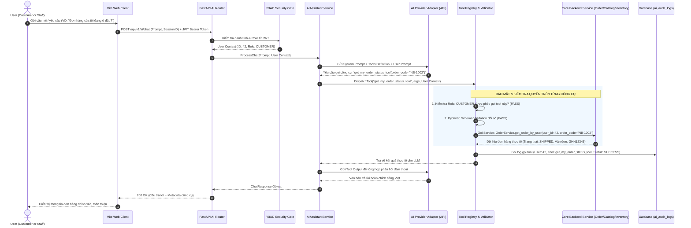
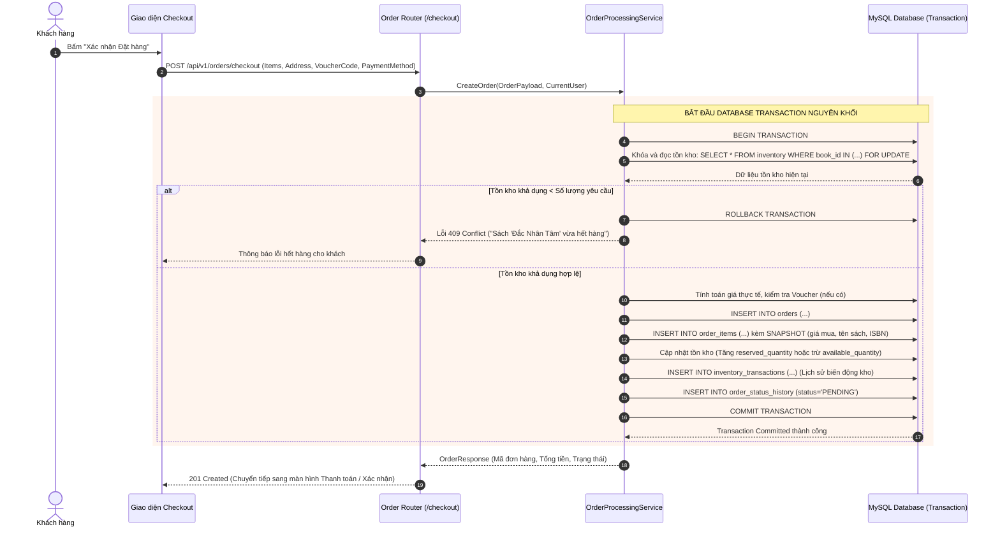

# NOVELIA BOOKS — SYSTEM ARCHITECTURE SPECIFICATION

> **Document ID:** DOC-02  
> **Version:** 1.0.0  
> **Status:** Approved / Baseline  
> **Authors:** Senior Software Architect, Technical Lead, AI Engineer, QA Lead  
> **Target Date:** 2026-10-19

---

## 1. ARCHITECTURAL OVERVIEW & GUIDING PRINCIPLES

Hệ thống **NOVELIA BOOKS** được thiết kế dựa trên các nguyên tắc kiến trúc phần mềm tiêu chuẩn doanh nghiệp (Enterprise Layered Architecture), đảm bảo các tiêu chí:
1. **Phân tách trách nhiệm (Separation of Concerns - SoC):** Tách biệt ranh giới giữa giao diện (Presentation), điều phối API (API Routing), quy tắc nghiệp vụ (Business Logic), truy xuất dữ liệu (Data Access) và tích hợp bên thứ ba (External Integrations).
2. **Backend làm chủ nghiệp vụ (Backend Authoritative):** Mọi quyết định về giá bán, chiết khấu, trừ kho, xác thực quyền hạn và trạng thái đơn hàng đều do backend xử lý và cam kết trong cơ sở dữ liệu.
3. **Phòng thủ theo chiều sâu (Defense-in-Depth):** Bảo mật được thực thi đa tầng từ mạng, xác thực phiên (JWT/Cookie), phân quyền API (FastAPI Dependencies), rào chắn công cụ AI (Tool Guardrails) cho đến ràng buộc cơ sở dữ liệu (Database Constraints).
4. **Kiến trúc cắm rút linh hoạt (Pluggable Integration Architecture):** Các nhà cung cấp dịch vụ bên ngoài (AI LLM, Cổng thanh toán, Đơn vị vận chuyển) đều được bọc qua các Interface trừu tượng, cho phép hoán đổi hoặc giả lập (Mock/Sandbox/Live) mà không làm ảnh hưởng đến mã nguồn cốt lõi.

---

## 2. SYSTEM ARCHITECTURE DIAGRAM (SƠ ĐỒ KIẾN TRÚC TỔNG THỂ)

```mermaid
flowchart TB
    subgraph CLIENT_TIER [Client Tier - Presentation]
        BrowserUser[Customer Web Browser]
        BrowserAdmin[Staff / Admin Web Browser]
        ViteApp[React 18 + TypeScript + Vite SPA\nTailwind CSS / shadcn/ui\nTanStack Query]
        BrowserUser --> ViteApp
        BrowserAdmin --> ViteApp
    end

    subgraph API_GATEWAY [API & Security Layer]
        FastAPIServer[FastAPI Server - Python 3.12+\nUvicorn ASGI]
        CORS_Middleware[CORS & Security Headers]
        Auth_Middleware[JWT Auth & RBAC Dependency Injection]
        Rate_Limiter[Rate Limiter & Request Validator]
        
        ViteApp -->|HTTPS / JSON REST API| CORS_Middleware
        CORS_Middleware --> Rate_Limiter
        Rate_Limiter --> Auth_Middleware
        Auth_Middleware --> FastAPIServer
    end

    subgraph BACKEND_LAYERS [Backend Application Architecture]
        subgraph ROUTING [Routers - api/v1]
            R_Auth[Auth Router]
            R_Store[Store & Catalog Router]
            R_Order[Order & Cart Router]
            R_Admin[Admin Dashboard Router]
            R_AI[Novelia AI Router]
        end

        subgraph SERVICES [Domain Services Layer]
            S_Auth[AuthService]
            S_Catalog[CatalogService]
            S_Order[OrderProcessingService\n(Atomic Transactions)]
            S_Inventory[InventoryService\n(Stock Locking)]
            S_Payment[PaymentOrchestrator]
            S_Shipping[ShippingOrchestrator]
            S_AI[AIAssistantService]
            S_BookMatch[BookMatchEngine]
        end

        subgraph REPOSITORIES [Data Access Repositories Layer]
            Repo_User[UserRepository]
            Repo_Book[BookRepository]
            Repo_Order[OrderRepository]
            Repo_Inv[InventoryRepository]
            Repo_Log[AuditLogRepository]
        end

        FastAPIServer --> ROUTING
        ROUTING --> SERVICES
        SERVICES --> REPOSITORIES
    end

    subgraph DATA_TIER [Persistence Tier]
        SQLAlchemy[SQLAlchemy 2.x ORM / Core]
        Alembic[Alembic Migration Engine]
        MySQL_Dev[(MySQL 8.x Server\nnovelia_books)]
        MySQL_Test[(MySQL 8.x Server\nnovelia_books_test)]
        
        REPOSITORIES --> SQLAlchemy
        Alembic -.->|Schema Versioning| MySQL_Dev
        SQLAlchemy -->|PyMySQL Connection Pool| MySQL_Dev
    end

    subgraph INTEGRATIONS [External Integrations Layer]
        subgraph AI_SUBSYSTEM [AI Subsystem]
            AI_Adapter[AI Provider Adapter\n(OpenAI / Gemini / Claude)]
            AI_ToolRegistry[Tool Registry & RBAC Guard]
            AI_Confirmation[Two-Phase Confirmation Gate]
        end

        subgraph PAYMENT_ADAPTERS [Payment Subsystem]
            Pay_Interface[PaymentProvider Interface]
            Pay_Mock[MockPaymentAdapter]
            Pay_VNPay[VNPay / MoMo Sandbox Adapter]
        end

        subgraph SHIPPING_ADAPTERS [Logistics Subsystem]
            Ship_Interface[ShippingProvider Interface]
            Ship_Mock[MockShippingAdapter]
            Ship_GHN[GHN / GHTK Live/Sandbox Adapter]
        end

        S_AI --> AI_ToolRegistry
        AI_ToolRegistry --> AI_Adapter
        AI_ToolRegistry --> AI_Confirmation
        AI_ToolRegistry -.->|Controlled Tool Execution| SERVICES

        S_Payment --> Pay_Interface
        Pay_Interface --> Pay_Mock
        Pay_Interface --> Pay_VNPay

        S_Shipping --> Ship_Interface
        Ship_Interface --> Ship_Mock
        Ship_Interface --> Ship_GHN
    end
```

---

## 3. BACKEND ARCHITECTURE (CHI TIẾT PHÂN LỚP BACKEND)

Backend tuân thủ cấu trúc phân tầng phân lập nghiêm ngặt:

```
FastAPI Router (Presentation)
       │  (Pydantic Request Schemas)
       ▼
Domain Service (Business Rules, State Machines, Pricing)
       │  (DTOs / Pure Python Data)
       ▼
Repository (Data Access Queries, Locking, Filtering)
       │  (SQLAlchemy Models)
       ▼
Database Engine (MySQL 8.x Transactions)
```

1. **Routers Layer (`app/api/v1/`):**
   - Chịu trách nhiệm nhận HTTP Request, giải mã JSON qua Pydantic Schemas.
   - Kiểm tra định danh và quyền hạn của người dùng thông qua Dependencies (`get_current_user`, `require_role(...)`).
   - Gọi phương thức tương ứng của Service và định dạng trả về Pydantic Response Schema với HTTP Status Code phù hợp (200, 201, 400, 401, 403, 404, 422, 500).
   - Tuyệt đối không chứa logic tính toán nghiệp vụ hay truy vấn SQL trực tiếp.

2. **Domain Service Layer (`app/services/`):**
   - Trái tim nghiệp vụ của hệ thống: kiểm tra điều kiện áp dụng voucher, tính toán tổng tiền, kiểm tra tồn kho khả dụng, điều phối chuyển đổi trạng thái đơn hàng.
   - Quản lý Database Session Transaction: Commit khi toàn bộ thao tác thành công hoặc Rollback khi có bất kỳ ngoại lệ nào phát sinh.

3. **Repository Layer (`app/repositories/`):**
   - Đóng gói toàn bộ logic truy vấn cơ sở dữ liệu bằng SQLAlchemy 2.x.
   - Cung cấp các phương thức CRUD chuẩn mực và các câu truy vấn phức tạp (tìm kiếm toàn văn, lọc kết hợp nhiều bảng, phân trang, khóa dòng dữ liệu `with_for_update`).

4. **Models Layer (`app/models/`):**
   - Định nghĩa các thực thể dữ liệu ánh xạ trực tiếp tới bảng MySQL bằng Declarative Base của SQLAlchemy 2.x.
   - Thiết lập khóa ngoại, quan hệ (`relationship`), chỉ mục (`Index`), và ràng buộc duy nhất (`UniqueConstraint`).

5. **External Integrations Layer (`app/integrations/`):**
   - Chứa các adapter giao tiếp với dịch vụ bên ngoài. Độc lập hoàn toàn với framework FastAPI; có thể tái sử dụng hoặc kiểm thử bằng unit test riêng biệt.

---

## 4. FRONTEND ARCHITECTURE (KIẾN TRÚC GIAO DIỆN)

Frontend được phát triển theo mô hình Single Page Application (SPA) hiện đại với **React 18+**, **TypeScript**, và **Vite**:

```
frontend/src/
├── assets/             # Hình ảnh tĩnh, icons, logos
├── components/         # Các components dùng chung
│   ├── ui/             # Primitive UI components (shadcn/ui / Radix)
│   ├── layout/         # Header, Footer, AdminSidebar, Navbar
│   ├── feedback/       # LoadingSpinner, ErrorAlert, EmptyState
│   └── chat/           # Novelia AIChatWidget, MessageList, ConfirmationCard
├── features/           # Components tổ chức theo tính năng nghiệp vụ
│   ├── auth/           # LoginForm, RegisterForm, AuthGuard
│   ├── catalog/        # BookCard, BookGrid, FilterSidebar, SearchBar
│   ├── cart/           # CartDrawer, CartItemRow, CartSummary
│   ├── checkout/       # CheckoutStepper, AddressSelector, PaymentMethodPicker
│   ├── orders/         # OrderHistoryTable, OrderDetailView, TrackingTimeline
│   └── admin/          # KpiCards, RevenueChart, BookManagementTable
├── hooks/              # Custom React hooks (useAuth, useCart, useDebounce)
├── services/           # Lớp gọi API tập trung
│   ├── apiClient.ts    # Cấu hình Axios / Fetch với interceptor bắt lỗi và gắn token
│   ├── authService.ts  # Các hàm gọi API xác thực
│   ├── bookService.ts  # Các hàm gọi API sách
│   └── aiService.ts    # Các hàm gọi API AI và SSE streaming
├── stores/             # Quản lý state toàn cục gọn nhẹ (Zustand)
├── types/              # Định nghĩa kiểu dữ liệu TypeScript đồng bộ với Pydantic Schemas
└── routes/             # Cấu hình định tuyến React Router v6 với Protected Routes
```

---

## 5. AI SUBSYSTEM ARCHITECTURE (KIẾN TRÚC PHÂN HỆ AI)

Phân hệ AI đóng vai trò là một điều phối viên thông minh (Intelligent Orchestrator), giao tiếp với người dùng và gọi các công cụ nội bộ đã được kiểm duyệt.



### Quy trình xác nhận hai bước cho thao tác thay đổi dữ liệu (Two-Phase Mutation Flow):
1. **Giai đoạn 1 (Đề xuất & Tạo bản nháp):**  
   Khi người dùng yêu cầu hành động thay đổi dữ liệu (ví dụ: Staff yêu cầu "Tạo bản nháp mã giảm giá HALLOWEEN giảm 20%"), AI gọi công cụ `draft_promotion_tool`. Công cụ này **chưa** ghi đè cấu hình sản xuất mà tạo ra một `PendingAction` lưu tạm, đồng thời trả về mã xác nhận `confirmation_token` và tóm tắt hành động.
2. **Giai đoạn 2 (Xác nhận & Thực thi):**  
   Giao diện hiển thị thẻ xác nhận trực quan (Confirmation Card). Người dùng phải bấm nút "Xác nhận thực hiện". Trình duyệt gửi yêu cầu `POST /api/v1/ai/confirm-action` kèm `confirmation_token`. Backend kiểm tra lại quyền hạn của phiên làm việc hiện tại trước khi thực hiện ghi dữ liệu thật và lưu vết vào `ai_audit_logs`.

---

## 6. ORDER PROCESSING & INVENTORY CONCURRENCY FLOW (LUỒNG XỬ LÝ ĐƠN HÀNG)



---

## 7. EXTERNAL INTEGRATIONS ABSTRACTION (LỚP TRỪU TƯỢNG HÓA TÍCH HỢP)

Để bảo đảm tính độc lập và khả năng kiểm thử, toàn bộ các dịch vụ bên ngoài đều tuân thủ nguyên tắc Dependency Inversion:

### 7.1. Payment Gateway Abstraction
```python
# app/integrations/payment/base.py
class PaymentProvider(ABC):
    @abstractmethod
    async def create_payment_url(self, order: Order, return_url: str) -> str:
        """Tạo liên kết thanh toán an toàn chuyển hướng người dùng."""
        pass

    @abstractmethod
    async def verify_webhook_signature(self, payload: dict, signature: str) -> bool:
        """Xác thực chữ ký số webhook chống giả mạo."""
        pass

    @abstractmethod
    async def parse_webhook_result(self, payload: dict) -> PaymentTransactionResult:
        """Chuẩn hóa dữ liệu kết quả thanh toán từ các bên thứ ba."""
        pass
```
- **MockPaymentAdapter:** Dành cho môi trường kiểm thử CI/CD và local khi chưa có tài khoản cổng thanh toán. Tự động phản hồi kết quả thành công/thất bại theo kịch bản.
- **VNPaySandboxAdapter / MoMoSandboxAdapter:** Dành cho môi trường tích hợp thực nghiệm với tài khoản thử nghiệm của nhà cung cấp.
- **LiveAdapter:** Chỉ kích hoạt khi có credentials chính thức và cấu hình môi trường production.

### 7.2. Shipping Carrier Abstraction
```python
# app/integrations/shipping/base.py
class ShippingProvider(ABC):
    @abstractmethod
    async def calculate_shipping_fee(self, from_address: Address, to_address: Address, weight_grams: int) -> Decimal:
        """Tính toán cước phí vận chuyển chính xác."""
        pass

    @abstractmethod
    async def create_shipment(self, order: Order) -> ShipmentCreationResult:
        """Gửi yêu cầu tạo đơn vận chuyển và nhận mã vận đơn."""
        pass

    @abstractmethod
    async def track_shipment(self, tracking_code: str) -> list[ShipmentTrackingEvent]:
        """Tra cứu lịch sử hành trình kiện hàng."""
        pass
```
- **MockShippingAdapter:** Giả lập chu kỳ giao hàng (Tạo vận đơn -> Đang lấy hàng -> Đang giao -> Đã giao) phục vụ kiểm thử và trình diễn đồ án.
- **GHNAdapter / GHTKAdapter:** Sẵn sàng kết nối qua REST API chính thức khi được cung cấp Token và ShopID.
