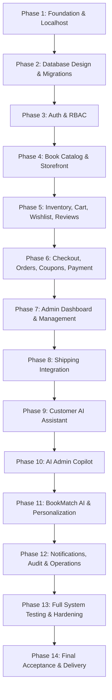

# NOVELIA BOOKS — MASTER IMPLEMENTATION ROADMAP (14 PHASES)

> **Document ID:** DOC-07  
> **Version:** 2.0.0  
> **Status:** Approved / Master Directive  
> **Authors:** Senior Software Architect, Technical Lead, AI Engineer, QA Lead  
> **Target Date:** 2026-10-19

---

## 1. QUY TẮC CHUNG CHO TẤT CẢ PHASE

Trước mỗi phase, đọc `AGENTS.md` và các tài liệu liên quan trong `docs/`.

Giữ nguyên kiến trúc bắt buộc:
- **Backend:** Python theo phiên bản tương thích với môi trường máy phát triển (Python 3.11+), FastAPI.
- **Database:** MySQL Server 8.x, quản trị bằng MySQL Workbench.
- **ORM:** SQLAlchemy 2.x, migration bằng Alembic.
- **Frontend:** React 18+, TypeScript và Vite.
- **AI:** API provider, tách lớp adapter để có thể thay nhà cung cấp.
- **Kiểm thử:** pytest, Vitest, React Testing Library và integration tests với MySQL thực tế (cấm SQLite).

Mọi phase phải:
1. Kiểm tra mã nguồn hiện tại trước khi sửa.
2. Không xóa hoặc ghi đè dữ liệu quan trọng.
3. Triển khai theo module, không dồn code vào một file.
4. Kiểm thử tính năng mới và chạy lại các kiểm thử bị ảnh hưởng.
5. Không sử dụng mock để tuyên bố tích hợp thật thành công.
6. Báo cáo file đã tạo/sửa, lệnh đã chạy, kết quả PASS/FAIL/BLOCKED.
7. Cập nhật tài liệu khi kiến trúc hoặc API thay đổi.
8. Dừng sau phase hiện tại, không tự triển khai phase kế tiếp.

---

## 2. LỘ TRÌNH 14 GIAI ĐOẠN CHI TIẾT

### PHASE 1 — FOUNDATION & LOCALHOST (HIỆN TẠI)
- **Mục tiêu:** Tạo nền móng frontend, backend và kết nối MySQL.
- **Công việc:**
  - Kiểm tra Python, Node.js, npm, Git và MySQL Server hiện có.
  - Chọn dependency tương thích với Python hiện tại.
  - Khởi tạo React + TypeScript + Vite.
  - Khởi tạo FastAPI, SQLAlchemy 2.x, PyMySQL, Pydantic Settings và Alembic.
  - Tạo cấu hình môi trường `.env.example` và `.gitignore`.
  - Tạo `GET /api/v1/health`.
  - Tạo `GET /api/v1/health/database` thực hiện `SELECT 1` trên MySQL.
  - Tạo giao diện nền tảng thể hiện trạng thái backend/database thật.
  - Cấu hình CORS theo origin development.
  - Thiết lập backend tests, frontend tests, lint, type-check và production build.
  - Viết hướng dẫn chạy trên Windows (`README.md`).
- **Nghiệm thu:**
  - Frontend và backend khởi động được.
  - Backend truy vấn thành công MySQL Server thật (hoặc báo lỗi chính xác không lộ secret).
  - Database health không báo thành công giả.
  - Các lệnh test, lint và build đã được thực thi (100% PASS).
  - Không đưa secret vào Git.

---

### PHASE 2 — DATABASE DESIGN & MIGRATIONS
- **Mục tiêu:** Xây dựng cơ sở dữ liệu hoàn chỉnh cho cửa hàng sách và AI.
- **Thiết kế các bảng:**
  - `users`, `roles`, `user_roles`, `user_addresses`, `user_preferences`.
  - `books`, `categories`, `authors`, `book_authors`, `publishers`, `book_images`.
  - `inventory`, `inventory_transactions`.
  - `carts`, `cart_items`, `wishlists`, `wishlist_items`.
  - `orders`, `order_items`, `payments`, `refund_requests`.
  - `coupons`, `coupon_usages`.
  - `shipments`, `shipment_events`.
  - `reviews`, `notifications`.
  - `ai_conversations`, `ai_messages`, `ai_action_logs`.
  - `user_book_events`, `book_recommendations`.
  - `audit_logs`.
- **Yêu cầu:** ERD, data dictionary, DECIMAL cho tiền, utf8mb4/InnoDB, snapshot đơn giá/sản phẩm tại thời điểm mua, cơ chế ngăn tồn kho âm, Alembic migration, seed dữ liệu demo có nhãn an toàn.

---

### PHASE 3 — AUTHENTICATION & ROLE-BASED ACCESS CONTROL
- **Mục tiêu:** Xây dựng hệ thống tài khoản và bảo vệ API.
- **Chức năng:** Đăng ký, đăng nhập, đăng xuất/thu hồi phiên, lấy user info hiện tại, đổi mật khẩu, cập nhật hồ sơ/địa chỉ, quản lý role `CUSTOMER`, `STAFF`, `ADMIN`, bảo vệ route theo role ở backend, giao diện Auth.
- **Bảo mật:** Argon2id/bcrypt, JWT hạn ngắn + Refresh token, chống IDOR, giới hạn thử đăng nhập.

---

### PHASE 4 — BOOK CATALOG & STOREFRONT
- **Mục tiêu:** Xây dựng cửa hàng sách và trải nghiệm khám phá sản phẩm.
- **Backend:** CRUD sách, danh mục, tác giả, NXB, tìm kiếm toàn văn, lọc đa tiêu chí, phân trang.
- **Frontend:** Trang chủ, trang cửa hàng, chi tiết sách, sách bán chạy/liên quan, responsive, loading/error/empty states.

---

### PHASE 5 — INVENTORY, CART, WISHLIST & REVIEWS
- **Mục tiêu:** Hoàn thiện tương tác khách hàng và quản lý tồn kho.
- **Nội dung:** Tồn kho thời gian thực, nhập kho, điều chỉnh kho có lý do + audit trail; Giỏ hàng đồng bộ DB; Wishlist; Đánh giá & số sao có kiểm soát chống spam.

---

### PHASE 6 — CHECKOUT, ORDERS, COUPONS & PAYMENT ABSTRACTION
- **Mục tiêu:** Xây dựng quy trình đặt hàng và thanh toán an toàn.
- **Nội dung:** Checkout nhiều bước, tính tổng tiền và chiết khấu tại backend, tạo mã đơn duy nhất, khóa tồn kho chống overselling, snapshot lịch sử, máy trạng thái đơn hàng, COD, lớp trừu tượng `PaymentProvider` (Sandbox VNPay/MoMo).

---

### PHASE 7 — ADMIN DASHBOARD & STORE MANAGEMENT
- **Mục tiêu:** Xây dựng trung tâm điều hành cửa hàng.
- **Nội dung:** Dashboard KPI doanh thu/đơn hàng/AOV/sách bán chạy/cảnh báo tồn kho đọc từ DB thật; quản lý sách, danh mục, đơn hàng, khách hàng, khuyến mãi, đánh giá; phân quyền nghiêm ngặt giữa `STAFF` và `ADMIN`.

---

### PHASE 8 — SHIPPING INTEGRATION
- **Mục tiêu:** Tích hợp quy trình vận chuyển có khả năng kết nối với nhà cung cấp thật.
- **Nội dung:** `ShippingProvider` interface, adapter GHN/GHTK, lưu mã vận đơn và tracking events, đồng bộ trạng thái webhook, tính phí giao hàng, phân định Mock/Sandbox/Live.

---

### PHASE 9 — CUSTOMER AI ASSISTANT
- **Mục tiêu:** Xây dựng chatbox AI giúp khách hàng tìm hiểu và thao tác trên website.
- **Nội dung:** Tách adapter AI, tool calling schema Pydantic, tìm sách, tra cứu đơn hàng cá nhân, kiểm tra tồn kho thật, không tự tạo SQL, cơ chế fallback khi AI lỗi.

---

### PHASE 10 — AI ADMIN COPILOT
- **Mục tiêu:** Cho phép quản trị viên dùng ngôn ngữ tự nhiên để hỗ trợ quản lý cửa hàng.
- **Nội dung:** Allowlist tools phân tích doanh thu, tồn kho, soạn thảo bản nháp nội dung sách và khuyến mãi; bắt buộc qua màn hình xem trước và bước xác nhận (Two-Phase Confirmation); audit log đầy đủ.

---

### PHASE 11 — BOOKMATCH AI & PERSONALIZATION
- **Mục tiêu:** Xây dựng hệ thống đề xuất sách cá nhân hóa.
- **Nội dung:** Đề xuất dựa trên thể loại, tác giả, gu đọc sách và lịch sử mua; giải thích lý do đề xuất; cơ chế fallback cho người dùng mới (cold-start); bảo vệ quyền riêng tư.

---

### PHASE 12 — NOTIFICATIONS, AUDIT & OPERATIONAL FEATURES
- **Mục tiêu:** Hoàn thiện thông báo, chăm sóc khách hàng và khả năng truy vết.
- **Nội dung:** Thông báo in-app, thông báo đổi trạng thái đơn và giao hàng, email xác nhận nếu có provider, audit trail cho hành động quản trị và AI, cơ chế retry an toàn.

---

### PHASE 13 — FULL SYSTEM TESTING & HARDENING
- **Mục tiêu:** Kiểm tra toàn diện hệ thống từ frontend đến MySQL, AI và provider ngoài.
- **Nội dung:** Toàn bộ test suite backend (MySQL thật) + frontend, kiểm thử concurrency, injection, security scanning, performance & index optimization.

---

### PHASE 14 — FINAL ACCEPTANCE & DELIVERY
- **Mục tiêu:** Hoàn thiện sản phẩm, tài liệu và quy trình trình diễn.
- **Nội dung:** Nghiệm thu end-to-end, kiểm tra dashboard dữ liệu thật, chạy toàn bộ test lần cuối, kịch bản demo bảo vệ đồ án, tài liệu hướng dẫn cài đặt và câu hỏi phản biện.
