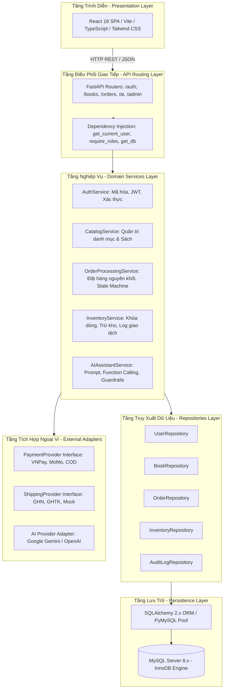
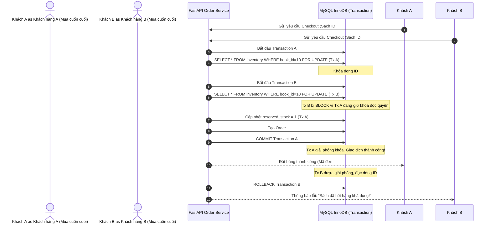
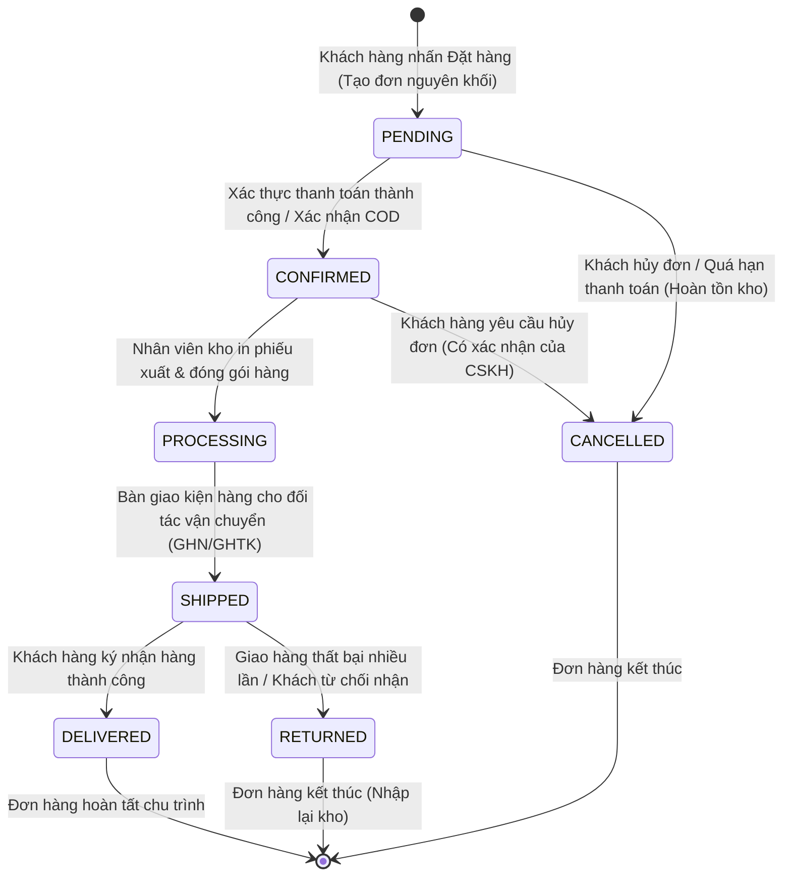
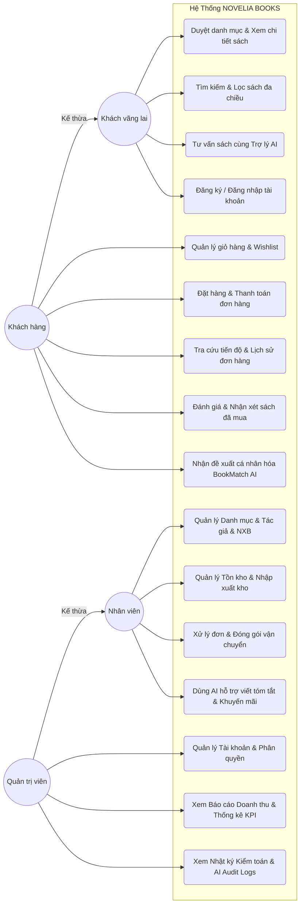
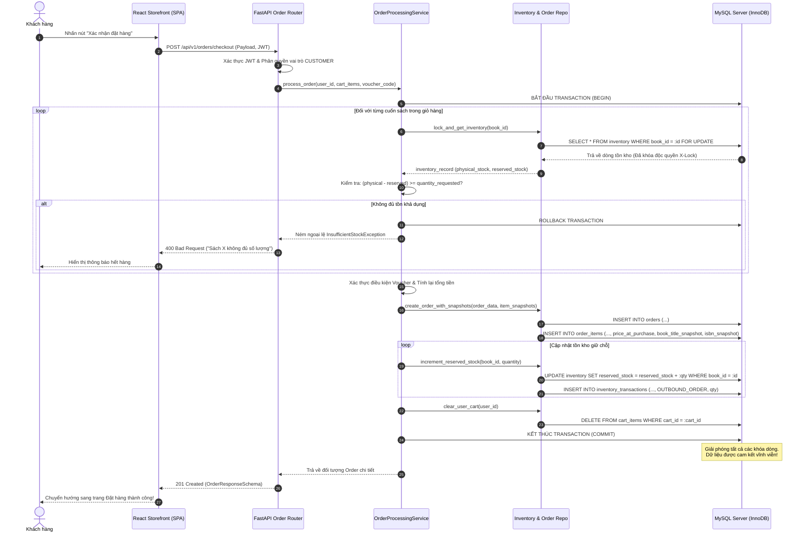
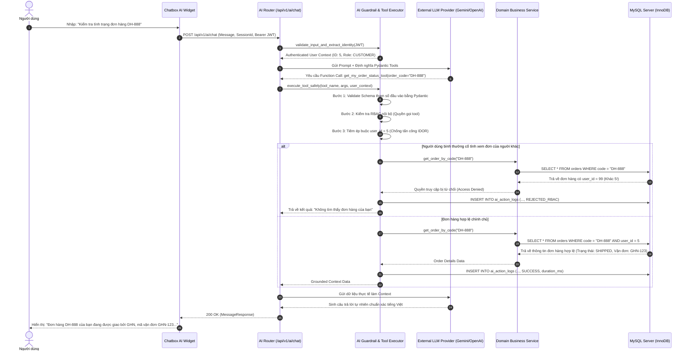

# TRƯỜNG ĐẠI HỌC CÔNG NGHỆ ĐÔNG Á
## KHOA CÔNG NGHỆ THÔNG TIN
### ĐỒ ÁN CHUYÊN NGÀNH CÔNG NGHỆ PHẦN MỀM

---

# BÁO CÁO ĐỒ ÁN CHUYÊN NGÀNH
**ĐỀ TÀI:**  
### **NGHIÊN CỨU VÀ XÂY DỰNG NỀN TẢNG THƯƠNG MẠI ĐIỆN TỬ BÁN SÁCH TRỰC TUYẾN TÍCH HỢP HỆ SINH THÁI TRỢ LÝ TRÍ TUỆ NHÂN TẠO (NOVELIA BOOKS)**

- **Người hướng dẫn:** ThS. Mai Văn Linh
- **Chuyên ngành:** Công nghệ phần mềm
- **Thời gian thực hiện:** Năm 2026
- **Địa điểm:** Bắc Ninh, 2026

---

# CHƯƠNG 1: CƠ SỞ LÝ THUYẾT, BÀI TOÁN NGHIỆP VỤ VÀ PHÂN TÍCH YÊU CẦU HỆ THỐNG

---

## 1.1. TỔNG QUAN VÀ BỐI CẢNH ĐỀ TÀI

### 1.1.1. Thực trạng ngành xuất bản và thương mại điện tử sách tại Việt Nam
Trong kỷ nguyên chuyển đổi số toàn diện và sự bùng nổ của nền kinh tế tri thức, ngành xuất bản và phát hành sách tại Việt Nam đang chứng kiến những bước chuyển mình mạnh mẽ. Theo số liệu thống kê từ Cục Xuất bản, In và Phát hành (Bộ Thông tin và Truyền thông), số lượng đầu sách xuất bản hàng năm liên tục tăng trưởng, đồng thời hành vi tiếp cận tri thức của độc giả, đặc biệt là thế hệ trẻ (Gen Z và Millennials), đã có sự dịch chuyển căn bản từ các nhà sách truyền thống sang các kênh mua sắm trực tuyến.

Thương mại điện tử (E-Commerce) ngành sách không đơn thuần là hoạt động số hóa danh mục và đặt hàng qua mạng, mà đã trở thành cầu nối văn hóa quan trọng, giúp lan tỏa văn hóa đọc đến mọi miền đất nước mà không bị giới hạn bởi rào cản địa lý. Tuy nhiên, thị trường bán lẻ sách trực tuyến tại Việt Nam hiện nay đang bộc lộ nhiều điểm nghẽn lớn:
1. **Trải nghiệm tìm kiếm và khám phá sách còn nghèo nàn:** Độc giả thường phải đối mặt với các danh mục phân loại cứng nhắc. Khả năng tìm kiếm theo ngữ nghĩa, theo cảm xúc, mục đích ứng dụng (ví dụ: *"Tìm sách phát triển tư duy phản biện cho sinh viên CNTT"* hay *"Sách chữa lành tâm hồn cho người mới đi làm"*) gần như không thể thực hiện hiệu quả bằng các công cụ tìm kiếm từ khóa truyền thống (Keyword-based Search).
2. **Thiếu vắng tính cá nhân hóa sâu sắc:** Đa phần các website sách hiện nay chỉ dừng lại ở các đề xuất chung chung như "Sách bán chạy" hoặc "Sách mới", không có khả năng thấu hiểu hành vi đọc, thị hiếu và lịch sử tương tác để đưa ra các đề xuất thực sự chạm đến nhu cầu của từng cá nhân độc giả.
3. **Thách thức trong quản lý chuỗi cung ứng và tồn kho thời gian thực:** Sách là mặt hàng có tính phân mảnh rất cao với hàng chục ngàn mã định danh quốc tế (ISBN), nhiều định dạng (bìa cứng, bìa mềm, ấn bản đặc biệt), cùng sự tham gia của nhiều tác giả, dịch giả và nhà xuất bản khác nhau. Tình trạng sai lệch dữ liệu tồn kho giữa hệ thống và thực tế, dẫn đến việc bán vượt tồn (overselling) hoặc hủy đơn hàng ngoài ý muốn của khách hàng, vẫn diễn ra phổ biến.
4. **Quy trình logistics và thanh toán phân tán:** Việc tính toán phí vận chuyển tự động theo kích thước, khối lượng thực tế và định vị hành chính (Tỉnh/Thành, Quận/Huyện, Phường/Xã) còn gặp nhiều độ trễ nếu thiếu một cơ chế kết nối linh hoạt và minh bạch với các đối tác giao vận lớn như Giao Hàng Nhanh (GHN) hay Giao Hàng Tiết Kiệm (GHTK).

### 1.1.2. Xu hướng chuyển dịch và cơ hội ứng dụng Trí tuệ nhân tạo (GenAI & LLM)
Sự đột phá mang tính bước ngoặt của các Mô hình Ngôn ngữ Lớn (Large Language Models - LLMs) như GPT-4, Google Gemini hay Claude đã định hình lại toàn bộ bức tranh tương tác giữa con người và máy tính. Trong lĩnh vực thương mại điện tử, AI không còn dừng lại ở các chatbot theo kịch bản dạng cây quyết định (Rule-based Chatbot) cứng nhắc và dễ gây ức chế cho người dùng. Thế hệ AI đàm thoại hiện đại sở hữu năng lực xử lý ngôn ngữ tự nhiên vượt trội, thấu hiểu ngữ cảnh sâu sắc và đặc biệt là khả năng "Gọi công cụ" (Function Calling / Tool Calling).

Khả năng này cho phép mô hình ngôn ngữ lớn đóng vai trò như một bộ não tư duy và điều phối (Orchestration Engine), có thể trực tiếp chuyển đổi ngôn ngữ tự nhiên của người dùng thành các tham số truy vấn có cấu trúc, gọi tới các API nghiệp vụ của hệ thống để:
- Tra cứu danh mục sách theo thời gian thực dựa trên nội dung ngữ nghĩa;
- Kiểm tra tính sẵn sàng của tồn kho và giá bán chính xác;
- Hỗ trợ khách hàng tra cứu trạng thái đơn hàng của chính họ theo thời gian thực;
- Hỗ trợ nhân viên quản trị (Staff/Admin) tự động sinh nội dung tóm tắt sách, trích xuất thông tin tác giả và dự thảo các chiến dịch khuyến mãi.

Bên cạnh đó, việc kết hợp giữa AI đàm thoại và các thuật toán gợi ý lai (Hybrid Recommendation) mở ra tiềm năng xây dựng tính năng **BookMatch AI** — một chuyên gia tư vấn sách ảo có khả năng phân tích gu đọc và đưa ra những khuyến nghị sách độc bản, có giải thích lý do đề xuất minh bạch, tạo nên sự gắn kết vượt trội giữa độc giả và nền tảng.

### 1.1.3. Khảo sát các giải pháp hiện nay và những khoảng trống công nghệ
Nhằm có cái nhìn toàn diện và khách quan, đề tài tiến hành khảo sát các mô hình kinh doanh và nền tảng bán sách trực tuyến tiêu biểu trong nước và quốc tế:

| Tiêu chí so sánh | Amazon Books | Fahasa Online / Tiki Books | Các website bán sách nhỏ lẻ (Wordpress/WooCommerce) | Nền tảng đề xuất NOVELIA BOOKS |
| :--- | :--- | :--- | :--- | :--- |
| **Quy mô kiến trúc** | Microservices phân tán cao cấp | Monolith / Microservices hỗn hợp | Monolithic đơn giản, plugin mở rộng | Clean Layered Architecture (FastAPI + React Vite) |
| **Tìm kiếm ngữ nghĩa & AI** | Recommendation Engine học sâu, trợ lý Rufus (US) | Tìm kiếm theo từ khóa truyền thống (Elasticsearch/Solr) | Tìm kiếm LIKE SQL cơ bản | Tìm kiếm toàn văn kết hợp Trợ lý Novelia AI (LLM Tool Calling) |
| **Tư vấn đàm thoại tiếng Việt** | Không hỗ trợ tiếng Việt chuyên sâu | Chatbot kịch bản tĩnh (FAQ / Livechat cơm) | Chatbot Facebook Messenger nhúng | Trợ lý AI tiếng Việt thông minh, tư vấn ngữ cảnh chuyên sâu |
| **Hệ thống đề xuất cá nhân hóa** | Collaborative Filtering quy mô lớn | Rule-based (Cùng tác giả, cùng danh mục) | Thủ công (Gắn thẻ sản phẩm liên quan) | BookMatch AI (Hybrid Recommendation + Lý giải đề xuất) |
| **Kiểm soát toàn vẹn giao dịch** | Hệ thống Eventual Consistency phân tán phức tạp | RDBMS + Message Queue | MySQL cơ bản, dễ gặp Race Condition khi flash sale | MySQL 8.x InnoDB, ACID Transaction, Pessimistic Row Locking |
| **Tích hợp vận chuyển & Thanh toán** | Hệ thống logistics nội bộ riêng | Tích hợp cổng thanh toán và vận chuyển đa dạng | Tích hợp plugin thanh toán COD cơ bản | Interface Adapter chuẩn hóa (GHN/GHTK, VNPay/MoMo Sandbox) |
| **Bảo mật & Rào chắn AI** | Độc quyền nội bộ | Chưa ứng dụng LLM trong tương tác dữ liệu | Không có | RBAC đa tầng, Zero Direct SQL, Two-Phase Confirmation Gate |

Từ bảng khảo sát trên, đề tài nhận diện những khoảng trống công nghệ rõ rệt: Các nền tảng trong nước vẫn thiếu vắng một giải pháp thương mại điện tử chuyên ngành sách vừa đảm bảo tính chuẩn mực về kiến trúc phần mềm doanh nghiệp, bảo toàn tính toán tài chính khắt khe, vừa tích hợp sâu sắc trí tuệ nhân tạo đàm thoại tiếng Việt với rào chắn bảo mật an toàn dữ liệu.

### 1.1.4. Đặt vấn đề và tính cấp thiết của đề tài NOVELIA BOOKS
Xuất phát từ thực tiễn và yêu cầu nâng cao chất lượng phần mềm trong môn học Đồ án chuyên ngành Công nghệ phần mềm, đề tài **"Nghiên cứu và xây dựng nền tảng thương mại điện tử bán sách trực tuyến tích hợp hệ sinh thái trợ lý trí tuệ nhân tạo (NOVELIA BOOKS)"** được lựa chọn thực hiện.

Đề tài giải quyết trực tiếp 3 bài toán trọng tâm:
1. **Bài toán công nghệ phần mềm và kiến trúc:** Xây dựng một hệ thống hoàn chỉnh theo chuẩn Enterprise Layered Architecture, phân tách rõ ràng trách nhiệm giữa Frontend, Backend API, Business Services, Repositories và Integrations, tuân thủ nghiêm ngặt các nguyên tắc SOLID và Clean Architecture.
2. **Bài toán toàn vẹn dữ liệu và nghiệp vụ bán lẻ:** Giải quyết triệt để vấn đề tranh chấp dữ liệu tồn kho (concurrency & race condition) khi nhiều người mua cùng lúc, chuẩn hóa tính toán tài chính với độ chính xác tuyệt đối (không làm tròn dấu phẩy động) và bảo tồn dữ liệu lịch sử đơn hàng thông qua cơ chế snapshot.
3. **Bài toán ứng dụng AI có rào chắn bảo mật (Safe AI Engineering):** Tích hợp mô hình ngôn ngữ lớn làm việc trực tiếp với dữ liệu nghiệp vụ thông qua cơ chế Tool Calling nhưng hoàn toàn không cấp quyền truy cập SQL trực tiếp, kiểm soát phân quyền đa tầng (RBAC) và bắt buộc xác nhận hai bước (Two-Phase Confirmation) đối với các hành vi thay đổi trạng thái hệ thống.

---

## 1.2. MỤC TIÊU, ĐỐI TƯỢNG VÀ PHẠM VI NGHIÊN CỨU

### 1.2.1. Mục tiêu của đề tài
#### a. Mục tiêu tổng quát
Nghiên cứu, thiết kế và phát triển hoàn chỉnh nền tảng thương mại điện tử bán sách trực tuyến NOVELIA BOOKS đạt chuẩn chất lượng doanh nghiệp, tích hợp hệ sinh thái AI trợ lý đàm thoại và đề xuất cá nhân hóa, sẵn sàng phục vụ quy trình kinh doanh bán lẻ từ khâu tiếp thị, tư vấn, đặt hàng, xử lý tồn kho đến vận chuyển và quản trị điều hành.

#### b. Mục tiêu cụ thể
1. **Về mặt nghiệp vụ bán hàng:**
   - Hoàn thiện 100% chu trình mua sắm: tìm kiếm đa chiều, duyệt danh mục, xem chi tiết sách phong phú, giỏ hàng thời gian thực, áp dụng mã giảm giá và quy trình thanh toán nhiều bước (checkout flow).
   - Thiết lập máy trạng thái đơn hàng (Order State Machine) minh bạch, quản lý trạng thái từ lúc chờ xác nhận đến khi hoàn tất giao hàng.
2. **Về mặt quản lý kho và tài chính:**
   - Quản lý đa danh mục thực thể sách phức tạp (tác giả, nhà xuất bản, thể loại quan hệ nhiều-nhiều, thông số kích thước, khối lượng, bìa).
   - Thiết kế hệ thống tồn kho phân tách giữa tồn kho vật lý (Physical Stock) và tồn kho giữ chỗ (Reserved Stock); kiểm soát biến động tồn kho thông qua nhật ký kiểm toán (Inventory Audit Log).
   - Thực thi các giao dịch đặt hàng nguyên khối (Atomic Transactions) với cơ chế khóa dòng dữ liệu (`SELECT ... FOR UPDATE`), ngăn chặn 100% rủi ro tồn kho âm.
3. **Về mặt công nghệ AI và cá nhân hóa:**
   - Xây dựng trợ lý ảo Novelia AI Assistant giao tiếp tiếng Việt tự nhiên, có khả năng gọi các công cụ nghiệp vụ nội bộ để tra cứu kho, danh mục và đơn hàng cá nhân.
   - Hiện thực hóa động cơ BookMatch AI đề xuất sách thông minh dựa trên hành vi đọc của khách hàng kèm giải thích lý do đề xuất.
   - Thiết kế và kiểm thử thành công hệ thống rào chắn AI Guardrails (Zero Direct SQL, Phân quyền RBAC tại backend, Two-Phase Confirmation cho các tác vụ đột biến).
4. **Về mặt tích hợp hệ thống bên ngoài:**
   - Thiết kế các lớp Adapter cắm rút linh hoạt cho Logistics (GHN, GHTK) và Thanh toán (VNPay, MoMo Sandbox).
5. **Về mặt kiến trúc và kiểm thử:**
   - Xây dựng mã nguồn backend với FastAPI (Python 3.12+), ORM SQLAlchemy 2.x, Alembic migrations trên hệ quản trị cơ sở dữ liệu MySQL Server 8.x thực tế.
   - Xây dựng frontend chuẩn Single Page Application (SPA) với React 18, TypeScript, Vite, Tailwind CSS và shadcn/ui.
   - Đạt độ bao phủ kiểm thử tự động với Pytest (Backend) và Vitest (Frontend), bảo đảm hệ thống vận hành ổn định và không phát sinh lỗi tiềm ẩn.

### 1.2.2. Đối tượng và khách thể nghiên cứu
- **Đối tượng nghiên cứu:** Các quy trình nghiệp vụ thương mại điện tử bán lẻ sách; các mô hình kiến trúc phần mềm phân tầng; các giải thuật kiểm soát đồng thời trong cơ sở dữ liệu; công nghệ xử lý ngôn ngữ tự nhiên và cơ chế Function Calling của các mô hình ngôn ngữ lớn (LLMs).
- **Khách thể nghiên cứu:** Nền tảng phần mềm NOVELIA BOOKS bao gồm hệ thống Storefront, Admin Portal, Backend Services và Subsystem AI.

### 1.2.3. Phạm vi nghiên cứu của đề tài
#### a. Phạm vi nội dung (In-Scope)
- **Storefront Web Application:** Giao diện người dùng tối ưu hóa trải nghiệm khách hàng trên nền web desktop và thiết bị di động responsive.
- **Quản trị người dùng & Phân quyền RBAC:** Phân định rõ 3 cấp vai trò: `CUSTOMER`, `STAFF`, `ADMIN`.
- **Quản lý danh mục & Tồn kho:** Quản trị toàn diện thực thể sách, tác giả, thể loại, nhà xuất bản, biến động xuất/nhập kho và cảnh báo tồn an toàn.
- **Xử lý đơn hàng & Thanh toán:** Cơ chế khóa dữ liệu đặt hàng nguyên khối, áp dụng mã voucher, cổng thanh toán giả lập / sandbox.
- **Vận chuyển & Tra cứu đơn hàng:** Tích hợp tính phí vận chuyển động và theo dõi sự kiện giao hàng (Shipment Tracking Events).
- **Phân hệ Admin Dashboard:** Báo cáo doanh thu, phân tích số liệu KPI bán hàng, quản lý đơn hàng và giám sát nhật ký AI Audit Log.
- **Novelia AI Assistant & BookMatch AI:** Trợ lý ảo đàm thoại và hệ sinh thái gợi ý sách cá nhân hóa an toàn.
- **Bộ kiểm thử tự động (Automated Testing Suite):** Bộ kịch bản kiểm thử tích hợp kết nối trực tiếp MySQL Server.

#### b. Giới hạn ngoài phạm vi (Out-of-Scope)
- Không phát triển sàn thương mại điện tử đa người bán (Multi-vendor Marketplace); hệ thống định vị là nền tảng bán lẻ sách đơn vị (Single-merchant Retail Platform).
- Không phát triển ứng dụng di động độc lập (Native iOS/Android App); sử dụng giao diện web responsive để đáp ứng toàn diện trình duyệt di động.
- Không trực tiếp lưu trữ thông tin thẻ tín dụng của khách hàng trên máy chủ (tuân thủ nguyên tắc không vi phạm chuẩn bảo mật PCI-DSS; sử dụng phương thức chuyển hướng gateway sandbox).
- Không cấp quyền cho trợ lý AI can thiệp trực tiếp hoặc chạy câu lệnh SQL thô trên cơ sở dữ liệu.

### 1.2.4. Phương pháp luận nghiên cứu và phát triển phần mềm
Đề tài áp dụng quy trình phát triển phần mềm hiện đại kết hợp giữa **Mô hình lặp và tăng trưởng (Iterative and Incremental Development)** cùng các nguyên lý của **Agile/Scrum**:
1. **Phương pháp nghiên cứu lý thuyết:** Thu thập, đọc hiểu và tổng hợp các tài liệu chuyên ngành về kiến trúc Clean Architecture, chuẩn REST API, tài liệu kỹ thuật về SQLAlchemy 2.0, FastAPI framework, cơ chế giao dịch MySQL InnoDB, các công trình nghiên cứu về Prompt Engineering, Tool Calling và AI Safety Guardrails.
2. **Phương pháp phân tích và thiết kế hệ thống:** Sử dụng ngôn ngữ mô hình hóa thống nhất (UML - Unified Modeling Language) để xây dựng biểu đồ Use Case, biểu đồ tuần tự (Sequence Diagram), biểu đồ lớp (Class Diagram) và mô hình thực thể liên kết (ERD) chuẩn hóa 3NF.
3. **Phương pháp thực nghiệm và kiểm thử phần mềm:** Triển khai mã nguồn thực tế trên môi trường máy chủ cục bộ và cơ sở dữ liệu thực, thực hiện kiểm thử tự động (Unit Test, Integration Test) và kiểm thử giao diện người dùng thực tế nhằm đánh giá độ tin cậy của toàn bộ hệ thống.

---

## 1.3. CƠ SỞ LÝ THUYẾT VÀ CÔNG NGHỆ NỀN TẢNG

### 1.3.1. Lý thuyết kiến trúc phân tầng (Clean Layered Architecture)
Kiến trúc phần mềm đóng vai trò quyết định đến độ bền vững, khả năng bảo trì và tính mở rộng của một hệ thống thương mại điện tử phức tạp. NOVELIA BOOKS áp dụng triệt để mô hình **Kiến trúc phân tầng sạch (Clean Layered Architecture)** lấy cảm hứng từ nguyên lý Domain-Driven Design (DDD):



**Các nguyên tắc cốt lõi của mô hình phân tầng:**
1. **Nguyên tắc phụ thuộc một chiều (Single Direction Dependency):** Các tầng bên ngoài phụ thuộc vào các tầng bên trong. Tầng cơ sở dữ liệu và API không được chứa mã nghiệp vụ logic; tầng nghiệp vụ (Services) hoàn toàn độc lập với các giao thức HTTP hoặc định dạng dữ liệu giao diện.
2. **Nguyên tắc phân tách ranh giới rõ ràng:**
   - **Tầng API (`app/api`):** Tiếp nhận yêu cầu HTTP, kiểm tra tính hợp lệ của schema đầu vào bằng Pydantic, gọi Service tương ứng và chuyển đổi dữ liệu kết quả thành Response Schema.
   - **Tầng Dịch vụ nghiệp vụ (`app/services`):** Đóng gói toàn bộ logic kinh doanh, tính toán tài chính, kiểm tra điều kiện tồn kho, quản lý giao dịch và điều phối sự kiện.
   - **Tầng Kho lưu trữ (`app/repositories`):** Chịu trách nhiệm thực hiện các truy vấn dữ liệu thuần túy (CRUD, Filter, Join) thông qua SQLAlchemy ORM hoặc Core, che giấu chi tiết cài đặt truy vấn đối với tầng dịch vụ.
   - **Tầng Tích hợp (`app/integrations`):** Cung cấp các giao diện trừu tượng (Interface/Abstract Base Class) để kết nối các dịch vụ ngoài, đảm bảo hệ thống có thể thay thế nhà cung cấp mà không cần sửa đổi logic nghiệp vụ cốt lõi.

### 1.3.2. Cơ sở dữ liệu quan hệ (RDBMS) và lý thuyết giao dịch ACID
Hệ thống thương mại điện tử đòi hỏi độ chính xác tuyệt đối trong mọi thao tác liên quan đến tiền tệ, đơn hàng và kho bãi. Cơ sở dữ liệu của NOVELIA BOOKS vận hành trên hệ quản trị **MySQL Server 8.x** sử dụng Storage Engine **InnoDB**, bảo đảm trọn vẹn 4 đặc tính **ACID**:
- **Tính nguyên tử (Atomicity):** Một giao dịch tạo đơn hàng bao gồm nhiều thao tác: kiểm tra tồn kho, trừ tồn khả dụng, tạo bản ghi đơn hàng, tạo các mục đơn hàng, áp dụng voucher và ghi lịch sử kho. Toàn bộ các thao tác này hoặc cùng thành công (Commit), hoặc nếu có bất kỳ lỗi nào xảy ra thì toàn bộ hệ thống sẽ được phục hồi nguyên trạng ban đầu (Rollback).
- **Tính nhất quán (Consistency):** Dữ liệu luôn chuyển dịch từ trạng thái hợp lệ này sang trạng thái hợp lệ khác. Tất cả các ràng buộc toàn vẹn khóa chính, khóa ngoại, ràng buộc kiểm tra (`CHECK physical_stock >= reserved_stock`, `CHECK price >= 0`) luôn được hệ quản trị duy trì nghiêm ngặt.
- **Tính cô lập (Isolation):** Các giao dịch thực thi đồng thời không được can thiệp hoặc nhìn thấy trạng thái trung gian chưa hoàn tất của nhau. Hệ thống sử dụng mức cô lập tiêu chuẩn `READ COMMITTED` hoặc `REPEATABLE READ` của InnoDB, kết hợp với kỹ thuật khóa tường minh.
- **Tính bền vững (Durability):** Một khi giao dịch đã được commit thành công, các thay đổi dữ liệu sẽ được ghi nhận vĩnh viễn vào nhật ký Redo Log và đĩa cứng, bảo đảm không bị mất dữ liệu ngay cả khi hệ thống gặp sự cố mất điện đột ngột.

### 1.3.3. Các chiến lược kiểm soát tranh chấp dữ liệu (Concurrency Control)
Trong các đợt mở bán sách giới hạn hoặc sự kiện khuyến mãi lớn (Flash Sale), hiện tượng hàng trăm khách hàng cùng lúc nhấn nút mua một cuốn sách có số lượng tồn kho có hạn là bài toán kinh điển của ngành công nghệ phần mềm. Nếu không có cơ chế kiểm soát đồng thời, hệ thống sẽ gặp lỗi **Race Condition**, dẫn đến việc bán vượt tồn kho (Overselling) — một lỗi nghiêm trọng trong thương mại điện tử.

Hệ thống NOVELIA BOOKS phân tích và áp dụng giải pháp **Khóa bi quan (Pessimistic Locking)** kết hợp khóa dòng dữ liệu trong cơ sở dữ liệu:

$$\text{Tồn khả dụng (Available Stock)} = \text{physical\_stock} - \text{reserved\_stock}$$

**Nguyên lý vận hành của cơ chế Pessimistic Locking:**
Khi tiến hành giao dịch thanh toán hoặc tạo đơn:
```sql
SELECT id, physical_stock, reserved_stock 
FROM inventory 
WHERE book_id = :target_book_id 
FOR UPDATE;
```
Câu lệnh `SELECT ... FOR UPDATE` đặt một khóa độc quyền (Exclusive Lock - X-Lock) lên đúng hàng (row) dữ liệu của cuốn sách đang được xử lý trong bảng `inventory`. Tất cả các giao dịch khác cố gắng đọc hoặc chỉnh sửa hàng này sẽ bị tạm dừng (block) cho đến khi giao dịch hiện tại hoàn tất (`COMMIT` hoặc `ROLLBACK`). 



Nhờ cơ chế này, hệ thống bảo đảm tính chính xác tuyệt đối, ngăn chặn triệt để hiện tượng dữ liệu rác hoặc tồn kho âm mà không cần dựa dẫm vào các giải pháp xử lý lỏng lẻo ở tầng ứng dụng.

### 1.3.4. Giao thức RESTful API và mô hình bất đồng bộ (Asynchronous ASGI Framework)
Toàn bộ kênh giao tiếp giữa máy trạm (Client) và máy chủ (Server) được thiết kế theo tiêu chuẩn kiến trúc **REST (Representational State Transfer)** qua giao thức HTTPS bảo mật:
- Sử dụng các danh từ đại diện cho tài nguyên (`/api/v1/books`, `/api/v1/orders`, `/api/v1/cart`).
- Sử dụng đúng các phương thức HTTP chuẩn (`GET`, `POST`, `PUT`, `PATCH`, `DELETE`).
- Mã trạng thái phản hồi HTTP chuẩn mực (`200 OK`, `201 Created`, `400 Bad Request`, `401 Unauthorized`, `403 Forbidden`, `404 Not Found`, `422 Unprocessable Entity`).

Backend sử dụng **FastAPI** — một nền tảng hiện đại được xây dựng trên nền **Starlette** và **Pydantic**, chạy trên nền tảng máy chủ ASGI (Asynchronous Server Gateway Interface) như **Uvicorn**:
- **Cơ chế Event Loop bất đồng bộ (`async`/`await`):** Cho phép một tiến trình đơn lẻ xử lý hàng nghìn kết nối đồng thời mà không bị nghẽn (non-blocking I/O). Trong khi chờ đợi kết quả I/O từ cơ sở dữ liệu MySQL hoặc từ API bên ngoài (như gọi LLM hoặc cổng thanh toán), luồng CPU được giải phóng để phục vụ các yêu cầu khác ngay lập tức.
- **Xác thực dữ liệu tự động với Pydantic v2:** Tất cả dữ liệu đầu vào và đầu ra đều được kiểm tra kiểu dữ liệu tĩnh nghiêm ngặt (Strict Data Typing). Các dữ liệu không hợp lệ đều bị từ chối ngay tại tầng cổng vào trước khi xâm nhập vào tầng nghiệp vụ.

### 1.3.5. Kiểm soát truy cập dựa trên vai trò (Role-Based Access Control - RBAC) và bảo mật Token
Bảo mật hệ thống NOVELIA BOOKS được thiết kế theo mô hình phân quyền chuẩn doanh nghiệp:
1. **Mô hình RBAC 3 cấp vai trò:**
   - `CUSTOMER`: Người dùng thông thường, có quyền quản lý giỏ hàng cá nhân, đặt đơn hàng, thanh toán, đánh giá sản phẩm đã mua và tra cứu thông tin cá nhân của chính mình.
   - `STAFF`: Nhân viên cửa hàng, có quyền quản lý kho, nhập/xuất kho, duyệt và đóng gói đơn hàng, cập nhật trạng thái vận chuyển và biên tập danh mục sách.
   - `ADMIN`: Quản trị viên hệ sinh thái, có toàn quyền trên toàn hệ thống: phân quyền tài khoản, xem các báo cáo tài chính/doanh thu nhạy cảm, cấu hình hệ thống, quản lý chiến dịch khuyến mãi và xem toàn bộ nhật ký kiểm toán hệ thống.
2. **Cơ chế xác thực Access Token & Refresh Token (JWT):**
   - **JSON Web Token (JWT):** Chứa các thông tin định danh người dùng (User ID, Email, Danh sách Roles) được ký số bằng thuật toán bảo mật `HMAC-SHA256` với khóa bí mật (`SECRET_KEY`).
   - **Access Token:** Có thời hạn ngắn (15 đến 30 phút), được đính kèm trong Header `Authorization: Bearer <token>` để xác thực từng yêu cầu API.
   - **Refresh Token:** Có thời hạn dài hơn (7 đến 30 ngày), được lưu trữ trong cơ sở dữ liệu và chuyển giao qua HTTP-only Secure Cookie nhằm ngăn chặn triệt để tấn công đánh cắp mã từ mã độc JavaScript (Cross-Site Scripting - XSS).
   - **Thuật toán băm mật khẩu:** Mật khẩu người dùng được băm bằng thuật toán **Argon2id** hoặc **bcrypt** với Salt ngẫu nhiên, bảo đảm không thể giải mã ngay cả khi cơ sở dữ liệu bị lộ lọt.
3. **Phòng chống lỗ hổng phân quyền ngang (Anti-IDOR - Insecure Direct Object References):**
   - Mọi truy vấn chi tiết tài nguyên cá nhân (ví dụ: `GET /api/v1/orders/{order_code}`) đều bắt buộc kiểm tra điều kiện:
     $$\text{order.user\_id} == \text{current\_user.id} \quad \lor \quad \text{current\_user.has\_role}(\text{'STAFF'}, \text{'ADMIN'})$$
   - Tuyệt đối không cho phép khách hàng sửa đổi `user_id` trên đường dẫn URL để truy cập trái phép dữ liệu của khách hàng khác.

### 1.3.6. Lý thuyết về Mô hình Ngôn ngữ Lớn (LLMs), Kỹ thuật Gọi công cụ và Rào chắn bảo mật AI
#### a. Mô hình Ngôn ngữ Lớn và Kỹ thuật Function Calling / Tool Calling
Mô hình Ngôn ngữ Lớn (LLM) là các mạng nơ-ron học sâu được huấn luyện trên lượng dữ liệu khổng lồ nhằm nắm bắt quy luật ngữ nghĩa và ngữ cảnh phức tạp của ngôn ngữ tự nhiên. Tuy nhiên, điểm yếu cố hữu của LLM là hiện tượng "ảo giác" (Hallucination) — tức tự bịa đặt ra các thông tin sai sự thật một cách thuyết phục, và không thể truy cập dữ liệu thời gian thực.

Để khắc phục hoàn toàn nhược điểm này trong thương mại điện tử, NOVELIA BOOKS áp dụng kỹ thuật tiên tiến nhất hiện nay: **LLM Function Calling / Tool Calling**:
1. Hệ thống định nghĩa danh sách các công cụ nghiệp vụ (Tools) dưới dạng lược đồ chuẩn Pydantic (tên hàm, mô tả chức năng, tham số yêu cầu và kiểu dữ liệu).
2. Khi người dùng nhập câu hỏi (ví dụ: *"Kiểm tra xem sách Nhà Giả Kim còn bao nhiêu cuốn và giá bao nhiêu?"*), prompt hệ thống cùng danh sách mô tả công cụ được gửi đến LLM.
3. Thay vì tự trả lời bằng văn bản phỏng đoán, LLM phân tích ngữ nghĩa và phản hồi một cấu trúc JSON yêu cầu gọi công cụ:
   ```json
   {
     "name": "check_stock_tool",
     "arguments": { "title": "Nhà Giả Kim" }
   }
   ```
4. Backend nhận tín hiệu gọi công cụ, kiểm tra tính hợp lệ của tham số, thực thi hàm nghiệp vụ nội bộ truy vấn cơ sở dữ liệu MySQL thực tế và thu về kết quả chính xác 100%:
   ```json
   { "book_id": 12, "title": "Nhà Giả Kim", "price": 79000, "available_stock": 15 }
   ```
5. Kết quả này được gửi ngược lại cho LLM để mô hình tổng hợp thành câu trả lời tự nhiên, thân thiện và chính xác tuyệt đối gửi đến người dùng.

#### b. Rào chắn bảo mật AI đa tầng (AI Guardrails Architecture)
Việc tích hợp LLM vào hệ thống doanh nghiệp tiềm ẩn nhiều rủi ro bảo mật nghiêm trọng như tấn công chèn câu lệnh độc hại (Prompt Injection), rò rỉ dữ liệu nhạy cảm hoặc AI tự ý thực thi các thao tác phá hoại dữ liệu. NOVELIA BOOKS thiết lập kiến trúc rào chắn bảo mật nghiêm ngặt (AI Guardrails) tại backend:
1. **Nguyên tắc "Zero Direct SQL":** AI tuyệt đối không sở hữu kết nối cơ sở dữ liệu trực tiếp và không được phép sinh câu lệnh SQL thô. Mọi tương tác chỉ được phép thông qua các hàm công cụ nghiệp vụ được mã hóa cứng.
2. **Xác thực quyền hạn tại Backend (Backend Re-Authorization):** Tham số `user_id` hoặc quyền hạn không bao giờ được nhận trực tiếp từ văn bản sinh ra của LLM. Backend luôn tiêm định danh người dùng thực tế từ phiên đăng nhập JWT vào ngữ cảnh gọi công cụ. Nếu một khách hàng bình thường cố tình hướng dẫn AI gọi công cụ quản trị (ví dụ: `adjust_inventory_tool`), backend sẽ chặn đứng ngay lập tức với mã lỗi `REJECTED_RBAC`.
3. **Cổng xác nhận hai bước (Two-Phase Confirmation Gate):** Mọi công cụ mang tính đột biến hoặc thay đổi dữ liệu (như hủy đơn hàng, áp dụng voucher đặc biệt) đều không được tự động thực thi. Backend sẽ trả về trạng thái `CONFIRMATION_REQUIRED` kèm mã xác nhận tạm thời (Ephemeral Confirmation Token). Giao diện người dùng sẽ hiển thị thẻ xác nhận trực quan để người dùng nhấn nút xác nhận chủ động trước khi thao tác được thực hiện trong cơ sở dữ liệu.
4. **Nhật ký kiểm toán AI (AI Audit Log):** 100% các lượt gọi công cụ đều được ghi nhận chi tiết vào bảng `ai_action_logs` để phục vụ công tác thanh tra, giám sát độ trễ và phát hiện các hành vi bất thường.

### 1.3.7. Lý thuyết hệ sinh thái khuyến nghị và cá nhân hóa (BookMatch AI)
Hệ thống đề xuất sách của NOVELIA BOOKS được xây dựng dựa trên nguyên lý **Hệ thống gợi ý lai (Hybrid Recommendation System)** kết hợp:
1. **Lọc dựa trên nội dung (Content-Based Filtering):** Phân tích các đặc trưng ngữ nghĩa của sách (thể loại, tác giả, nhà xuất bản, từ khóa chủ đề, trích đoạn) để tính toán độ tương đồng cosine (Cosine Similarity) với các cuốn sách mà độc giả đã đọc hoặc thêm vào danh sách yêu thích (Wishlist).
2. **Phân tích hành vi tương tác có sự đồng thuận (Explicit & Implicit User Signals):** Thu thập các tín hiệu tương tác được người dùng cho phép thông qua bảng `user_book_events` (lượt xem chi tiết sách, thời gian dừng trên trang, thao tác thêm giỏ hàng, lịch sử mua thực tế và đánh giá số sao).
3. **Thuật toán giải quyết bài toán khởi động lạnh (Cold-Start Problem):** Đối với độc giả mới chưa có lịch sử tương tác, hệ thống tự động kích hoạt bộ gợi ý fallback thông minh dựa trên độ thịnh hành (Trending), điểm đánh giá uy tín từ cộng đồng và khảo sát nhanh sở thích đọc lúc đăng ký tài khoản.
4. **Minh bạch hóa lý do đề xuất (Explainable AI):** Mỗi đầu sách được BookMatch AI gợi ý đều đi kèm một câu giải thích rõ ràng (ví dụ: *"Gợi ý cho bạn vì bạn đã đọc và yêu thích cuốn 'Sapiens' của cùng tác giả Yuval Noah Harari"*), giúp gia tăng độ tin cậy và kích thích quyết định mua hàng của độc giả.

---

## 1.4. KHẢO SÁT VÀ PHÂN TÍCH BÀI TOÁN NGHIỆP VỤ

### 1.4.1. Quy trình quản lý danh mục sách và siêu dữ liệu đa quan hệ
Danh mục sách là tài nguyên trung tâm của nền tảng, có đặc thù cấu trúc dữ liệu phức tạp hơn nhiều so với các mặt hàng tiêu dùng thông thường:
- **Quan hệ nhiều-nhiều (Many-to-Many):** Một cuốn sách có thể được đồng sáng tác bởi nhiều tác giả, dịch bởi nhiều dịch giả và thuộc về nhiều danh mục/thể loại khác nhau (ví dụ: một cuốn sách vừa thuộc thể loại *Kinh tế*, vừa thuộc thể loại *Kỹ năng sống*). Cơ sở dữ liệu giải quyết bằng các bảng liên kết chuẩn hóa (`book_authors`, `book_categories`).
- **Siêu dữ liệu định chuẩn xuất bản:** Mỗi cuốn sách bắt buộc phải quản lý các trường dữ liệu tiêu chuẩn: mã định danh quốc tế ISBN-10 / ISBN-13, mã định danh kho nội bộ (SKU), trọng lượng (gram) và kích thước ba chiều (dài, rộng, cao theo mm phục vụ tính thể tích quy đổi cước vận chuyển), số trang, loại bìa (bìa cứng, bìa mềm, bìa da cao cấp), năm xuất bản, ngôn ngữ và số lần tái bản.
- **Vòng đời trạng thái sản phẩm:** Mỗi đầu sách trải qua các trạng thái quản trị: `DRAFT` (Bản nháp đang biên tập) $\rightarrow$ `ACTIVE` (Đang mở bán công khai) $\rightarrow$ `OUT_OF_STOCK` (Tạm hết hàng) $\rightarrow$ `DISCONTINUED` (Ngừng kinh doanh).

### 1.4.2. Quy trình giỏ hàng, đặt hàng và máy trạng thái đơn hàng (Order State Machine)
Đơn hàng là trung tâm của các giao dịch kinh tế trong hệ thống. Quy trình từ lúc khách hàng duyệt sách đến khi nhận hàng thành công được chuẩn hóa thành một máy trạng thái hữu hạn (Finite State Machine - FSM):



**Quy tắc bảo toàn tài chính và snapshot dữ liệu:**
Một yêu cầu bắt buộc trong kỹ nghệ phần mềm tài chính là **Bảo toàn dữ liệu lịch sử đơn hàng (Order Snapshotting)**:
- Giá của một cuốn sách có thể thay đổi theo thời gian, các chương trình khuyến mãi có thể kết thúc hoặc thông tin tiêu đề sách có thể được chỉnh sửa.
- Tại thời điểm tạo đơn hàng, bảng `order_items` bắt buộc phải lưu lại một bản chụp cố định các trường: `book_title_snapshot`, `book_isbn_snapshot`, `book_sku_snapshot` và `price_at_purchase` (đơn giá mua thực tế tại giây phút đặt hàng).
- Mọi biến động giá cả trong tương lai tuyệt đối không được làm thay đổi tổng tiền của các hóa đơn đã ký kết trong quá khứ.

### 1.4.3. Quy trình quản lý tồn kho và bảo toàn tính toàn vẹn
Hệ thống tồn kho của NOVELIA BOOKS không sử dụng một trường số lượng đơn lẻ mà quản trị tồn kho theo mô hình kế toán kho thời gian thực:
1. **Phân định hai đại lượng tồn kho cốt lõi:**
   - **Tồn kho vật lý (`physical_stock`):** Tổng số lượng sách thực tế đang nằm trên giá kệ trong kho của cửa hàng.
   - **Tồn kho giữ chỗ (`reserved_stock`):** Số lượng sách đã được khách hàng đặt mua thành công và đang nằm trong các đơn hàng chờ đóng gói hoặc đang vận chuyển.
   - **Tồn kho khả dụng (`available_stock`):** Số lượng thực tế khách hàng mới có thể đưa vào giỏ hàng và đặt mua.
2. **Cơ chế lưu vết biến động (Inventory Audit Logging):**
   Mọi hành động làm thay đổi tồn kho đều bắt buộc sinh ra một bản ghi trong bảng `inventory_transactions` với các thông tin: mã giao dịch, mã sách, loại giao dịch (`INBOUND_IMPORT` - Nhập hàng từ NXB; `OUTBOUND_ORDER` - Xuất hàng theo đơn; `RETURN_RESTOCK` - Khách trả hàng hoàn kho; `MANUAL_ADJUSTMENT` - Điều chỉnh kiểm kê kho), số lượng biến động, số tồn trước và sau biến động, mã nhân viên thực hiện và ghi chú lý do.
3. **Cơ chế cảnh báo tồn an toàn (Safety Stock Alerts):**
   Hệ thống cho phép thiết lập ngưỡng tồn kho an toàn cho từng đầu sách. Khi tồn kho khả dụng giảm xuống dưới ngưỡng này, hệ thống tự động gắn cờ cảnh báo trên giao diện Admin Dashboard và hỗ trợ trợ lý AI nhắc nhở nhân viên lập kế hoạch nhập hàng mới.

### 1.4.4. Quy trình tích hợp dịch vụ vận chuyển và cổng thanh toán trực tuyến
1. **Kiến trúc tích hợp Logistics (Shipping Subsystem):**
   - Áp dụng mẫu thiết kế **Strategy Pattern** và **Adapter Pattern** thông qua giao diện trừu tượng `ShippingProvider`.
   - Hệ thống cung cấp các adapter kết nối tới API của **Giao Hàng Nhanh (GHN)** và **Giao Hàng Tiết Kiệm (GHTK)** để tự động đồng bộ danh mục hành chính (Tỉnh/Thành, Quận/Huyện, Phường/Xã), tính toán cước phí vận chuyển chính xác theo khối lượng, tạo vận đơn và lắng nghe Webhook cập nhật tiến độ di chuyển của bưu kiện.
   - Để phục vụ môi trường phát triển và kiểm thử, hệ thống cung cấp `MockShippingProvider` mô phỏng đầy đủ quy trình giao vận thực tế mà không đòi hỏi tài khoản doanh nghiệp trực tiếp.
2. **Kiến trúc tích hợp Cổng thanh toán (Payment Subsystem):**
   - Hỗ trợ phương thức thanh toán truyền thống: **Thanh toán khi nhận hàng (COD - Cash On Delivery)**.
   - Xây dựng lớp trừu tượng `PaymentProvider` tích hợp các cổng thanh toán điện tử phổ biến tại Việt Nam như **VNPay** và **MoMo Sandbox**.
   - Quy trình xử lý thanh toán đảm bảo an toàn tuyệt đối thông qua cơ chế mã hóa chữ ký số băm mật mã (HMAC-SHA512 Checksum), kiểm tra tính toàn vẹn của gói tin phản hồi (IPN - Instant Payment Notification) trước khi cập nhật trạng thái thanh toán của đơn hàng.

### 1.4.5. Quy trình đối soát tài chính và báo cáo quản trị vận hành
Phân hệ quản trị (Admin Portal) đóng vai trò là trung tâm điều hành toàn bộ nền tảng:
- **Tính toán chỉ số tài chính thời gian thực:** Doanh thu thuần (Net Revenue), Lợi nhuận gộp, Số lượng đơn hàng mới, Tỷ lệ hủy đơn, Giá trị trung bình của một đơn hàng (Average Order Value - AOV).
- **Phân tích hành vi khách hàng:** Tổng giá trị vòng đời khách hàng (Customer Lifetime Value - LTV), tỷ lệ khách hàng quay lại mua tiếp.
- **Biểu đồ trực quan hóa số liệu:** Biểu đồ doanh thu theo ngày/tháng/năm, biểu đồ cơ cấu doanh thu theo thể loại sách, bảng xếp hạng Top 10 sách bán chạy nhất. Toàn bộ dữ liệu hiển thị đều được tính toán từ các câu lệnh tổng hợp (Aggregation Queries) trực tiếp trên cơ sở dữ liệu MySQL, nói không với việc sinh số liệu giả lập tĩnh trên giao diện.

---

## 1.5. ĐẶC TẢ YÊU CẦU HỆ THỐNG (SYSTEM REQUIREMENTS SPECIFICATION)

### 1.5.1. Xác định các tác nhân hệ thống (System Actors & User Personas)
Hệ thống NOVELIA BOOKS phục vụ 5 nhóm tác nhân chính:

| Tác nhân (Actor) | Bản chất | Mô tả vai trò và quyền hạn tương tác trong hệ thống |
| :--- | :--- | :--- |
| **Khách vãng lai (Guest)** | Người dùng chưa đăng nhập | Xem trang chủ, duyệt danh mục, tìm kiếm sách, xem chi tiết sách, trò chuyện với trợ lý AI ở phạm vi tư vấn chung, thêm sách vào giỏ hàng tạm thời. |
| **Khách hàng (Customer)** | Người dùng đã đăng thực | Quản trị hồ sơ cá nhân, sổ địa chỉ nhận hàng, quản lý giỏ hàng, thực hiện quy trình checkout, thanh toán, xem lịch sử đơn hàng, theo dõi hành trình kiện hàng, gửi đánh giá nhận xét và nhận gợi ý cá nhân hóa từ BookMatch AI. |
| **Nhân viên cửa hàng (Staff)** | Người dùng nội bộ vận hành | Quản lý danh mục sách, quản lý xuất nhập tồn kho, kiểm duyệt đơn hàng, in phiếu xuất, đóng gói, bàn giao vận chuyển, sử dụng AI hỗ trợ soạn thảo nội dung sách. |
| **Quản trị viên (Admin)** | Người dùng quản trị cao nhất | Toàn quyền kiểm soát hệ thống: quản lý tài khoản người dùng và phân quyền nhân viên, cấu hình tham số hệ sinh thái, theo dõi báo cáo doanh thu tài chính, quản lý mã voucher, kiểm tra hệ thống nhật ký kiểm toán và giám sát chi phí/hoạt động của AI. |
| **Hệ thống ngoài (External Services)** | Hệ thống máy tính bên thứ ba | Nhà cung cấp AI (Google Gemini / OpenAI), Cổng thanh toán (VNPay / MoMo Sandbox), Đơn vị vận chuyển (GHN / GHTK). |

---

### 1.5.2. Đặc tả yêu cầu chức năng (Functional Requirements - FRs)

#### Phân hệ 1: Cửa hàng trực tuyến (Storefront)
- **FR-ST-01 (Trang chủ sinh động):** Hiển thị banner khuyến mãi, danh mục sách tiêu biểu, cụm sách mới phát hành, bảng xếp hạng sách bán chạy nhất và khu vực khám phá cá nhân hóa BookMatch AI.
- **FR-ST-02 (Bộ lọc & Tìm kiếm đa chiều):** Hỗ trợ tìm kiếm toàn văn (Full-text Search) theo tiêu đề sách, tên tác giả, nhà xuất bản hoặc mã ISBN; kết hợp bộ lọc linh hoạt theo thể loại, khoảng giá tiền, mức đánh giá sao, loại bìa và tình trạng còn hàng khả dụng.
- **FR-ST-03 (Trang chi tiết sách chuyên sâu):** Hiển thị bộ sưu tập hình ảnh chất lượng cao, thông số kỹ thuật chi tiết (ISBN, số trang, kích thước, khối lượng, nhà xuất bản), tóm tắt nội dung, đoạn trích đọc thử, giá niêm yết, giá khuyến mãi và số lượng tồn kho tức thời.
- **FR-ST-04 (Đánh giá & Bình luận có kiểm chứng):** Cho phép những khách hàng đã thực sự mua và nhận sách thành công để lại đánh giá từ 1 đến 5 sao cùng nhận xét chi tiết; tự động tính toán điểm đánh giá trung bình.
- **FR-ST-05 (Danh sách yêu thích - Wishlist):** Người dùng có thể lưu các đầu sách yêu thích vào danh sách cá nhân và nhận thông báo khi sách có biến động giảm giá.
- **FR-ST-06 (Giỏ hàng tương tác cao):** Cho phép thêm sách, điều chỉnh số lượng, kiểm tra ngay tính sẵn sàng của tồn kho trước khi chuyển sang bước thanh toán, hiển thị chi tiết tạm tính.
- **FR-ST-07 (Quy trình thanh toán chuẩn mực):** Quy trình checkout trực quan gồm các bước: chọn địa chỉ giao hàng từ sổ địa chỉ, lựa chọn đơn vị vận chuyển, áp dụng mã voucher giảm giá, chọn phương thức thanh toán và kiểm tra bảng tóm tắt chi phí trước khi gửi đơn.
- **FR-ST-08 (Quản lý hồ sơ & Lịch sử đơn hàng):** Khách hàng chủ động quản lý thông tin tài khoản, danh sách địa chỉ nhận hàng, tra cứu lịch sử mua hàng kèm chi tiết từng trạng thái và mã theo dõi vận đơn.
- **FR-ST-09 (Giao diện Chatbox AI nổi):** Cung cấp widget trò chuyện AI nổi ở góc màn hình, cho phép khách hàng tương tác đàm thoại với Novelia AI Assistant tại bất kỳ vị trí nào trên website.

#### Phân hệ 2: Xác thực & Quản lý truy cập (Authentication & RBAC)
- **FR-AUTH-01 (Đăng ký an toàn):** Đăng ký tài khoản bằng Email và Mật khẩu; kiểm tra định dạng email chuẩn và độ mạnh mật khẩu (tối thiểu 8 ký tự, có chữ hoa, số và ký tự đặc biệt). Mật khẩu được mã hóa an toàn bằng thuật toán Argon2id / bcrypt.
- **FR-AUTH-02 (Đăng nhập & Quản lý phiên):** Xác thực tài khoản, cấp phát cặp mã Access Token (JWT thời hạn ngắn) và Refresh Token được bảo vệ trong HTTP-only Secure Cookie chống tấn công XSS.
- **FR-AUTH-03 (Phân quyền 3 cấp):** Phân chia quyền hạn rõ ràng theo 3 vai trò: `CUSTOMER`, `STAFF`, `ADMIN`.
- **FR-AUTH-04 (Kiểm soát quyền chặt chẽ tại Backend):** Toàn bộ các API riêng tư đều bắt buộc kiểm tra quyền hạn thông qua cơ chế Dependency Injection của FastAPI. Tuyệt đối không phụ thuộc vào việc ẩn/hiển thị giao diện người dùng để bảo mật.
- **FR-AUTH-05 (Thu hồi phiên làm việc):** Hỗ trợ chức năng đăng xuất, lập tức thu hồi và vô hiệu hóa Refresh Token trong cơ sở dữ liệu.

#### Phân hệ 3: Quản lý Danh mục & Tồn kho (Catalog & Inventory)
- **FR-CAT-01 (CRUD Danh mục đa thực thể):** Quản lý toàn diện Sách (Books), Tác giả (Authors), Thể loại (Categories) và Nhà xuất bản (Publishers). Hỗ trợ quan hệ nhiều-nhiều giữa sách, tác giả và thể loại.
- **FR-CAT-02 (Quản lý mã định danh):** Tự động kiểm tra tính duy nhất của mã ISBN và mã SKU trên toàn bộ danh mục sản phẩm.
- **FR-CAT-03 (Quản trị giá chuẩn xác):** Quản lý giá bìa và giá bán lẻ khuyến mãi với kiểu dữ liệu `DECIMAL(12, 2)`, nghiêm cấm làm tròn dấu phẩy động.
- **FR-INV-01 (Theo dõi tồn kho theo thời gian thực):** Hệ thống tách biệt rõ ràng giữa tồn kho vật lý (`physical_stock`), tồn kho giữ chỗ (`reserved_stock`) và tồn kho khả dụng (`available_stock`).
- **FR-INV-02 (Nhật ký giao dịch kho):** Bắt buộc lưu vết mọi thao tác xuất, nhập, điều chỉnh kho thành các bản ghi giao dịch kế toán kho (`inventory_transactions`).
- **FR-INV-03 (Cảnh báo chạm ngưỡng tồn an toàn):** Hệ thống tự động phát hiện và cảnh báo cho nhân viên khi số lượng khả dụng của một cuốn sách thấp hơn mức định mức an toàn.

#### Phân hệ 4: Quản lý Đơn hàng & Xử lý Thanh toán (Order & Payment)
- **FR-ORD-01 (Tạo đơn hàng nguyên khối):** Thực thi toàn bộ thao tác kiểm tra tồn kho, khóa dòng dữ liệu (`SELECT ... FOR UPDATE`), tính toán giá trị, trừ tồn kho và tạo đơn trong một giao dịch cơ sở dữ liệu duy nhất, ngăn ngừa triệt để lỗi tranh chấp dữ liệu.
- **FR-ORD-02 (Bảo toàn bản chụp lịch sử):** Bảng chi tiết đơn hàng bắt buộc lưu trữ bản chụp cố định về đơn giá mua, tên sách, mã ISBN và SKU tại thời điểm mua hàng.
- **FR-ORD-03 (Quản lý máy trạng thái đơn hàng):** Kiểm soát tính hợp lệ của việc chuyển dịch trạng thái đơn hàng (`PENDING` $\rightarrow$ `CONFIRMED` $\rightarrow$ `PROCESSING` $\rightarrow$ `SHIPPED` $\rightarrow$ `DELIVERED` / `CANCELLED`) và lưu vết lịch sử chuyển đổi.
- **FR-ORD-04 (Động cơ khuyến mãi Voucher):** Hỗ trợ giảm giá theo tỷ lệ phần trăm (kèm trần giảm tối đa) hoặc giảm tiền cố định; kiểm tra điều kiện đơn hàng tối thiểu và giới hạn số lượt sử dụng.
- **FR-PAY-01 (Thanh toán COD):** Xử lý đơn hàng thanh toán tiền mặt khi nhận hàng với luồng xác thực đơn chuẩn.
- **FR-PAY-02 (Cổng thanh toán điện tử):** Hỗ trợ tạo liên kết thanh toán VNPay / MoMo Sandbox kèm chữ ký số bảo mật HMAC-SHA512; tiếp nhận và xác thực thông báo thanh toán tức thời (IPN Webhook).

#### Phân hệ 5: Quản lý Vận chuyển & Giao nhận (Logistics & Shipping)
- **FR-SHIP-01 (Tính cước động):** Tự động tính toán phí giao hàng dựa trên trọng lượng/thể tích của giỏ hàng và địa chỉ giao hàng hành chính của khách hàng.
- **FR-SHIP-02 (Khởi tạo vận đơn tự động):** Gửi yêu cầu và nhận mã vận đơn chính thức từ đơn vị vận chuyển khi đơn hàng chuyển sang trạng thái sẵn sàng xuất kho.
- **FR-SHIP-03 (Theo dõi hành trình bưu kiện):** Lưu vết toàn bộ các sự kiện dịch chuyển của kiện hàng (`shipment_events`), cung cấp giao diện tra cứu tiến độ bưu kiện trực quan cho khách hàng.
- **FR-SHIP-04 (Cơ chế hoạt động minh bạch):** Phân định rõ ràng giữa chế độ chạy thử nghiệm (`MOCK`), kiểm thử (`SANDBOX`) và vận hành thực tế (`LIVE`).

#### Phân hệ 6: Quản trị cửa hàng & Báo cáo số liệu (Admin Dashboard)
- **FR-ADM-01 (Bảng điều khiển KPI trực quan):** Báo cáo tức thời các chỉ số doanh thu thuần, đơn hàng mới, khách hàng mới, tỷ lệ hoàn tất đơn hàng và giá trị đơn trung bình.
- **FR-ADM-02 (Biểu đồ phân tích kinh doanh):** Trực quan hóa doanh số theo thời gian thực dựa trên số liệu tổng hợp trực tiếp từ cơ sở dữ liệu.
- **FR-ADM-03 (Bảng xếp hạng sách bán chạy):** Thống kê các đầu sách có doanh số và doanh thu cao nhất theo kỳ báo cáo.
- **FR-ADM-04 (Xử lý đơn hàng tập trung):** Bộ công cụ quản trị đơn hàng cho phép lọc theo trạng thái, tìm kiếm nhanh, in phiếu xuất kho và cập nhật tiến độ đóng gói.
- **FR-ADM-05 (Quản lý người dùng & Phân quyền):** Quản lý danh sách khách hàng, lịch sử mua sắm, trạng thái khóa/mở tài khoản và phân quyền cho nhân viên.
- **FR-ADM-06 (Giám sát hệ thống & Nhật ký AI):** Theo dõi nhật ký kiểm toán hệ thống (`audit_logs`) và nhật ký gọi công cụ AI (`ai_action_logs`).

#### Phân hệ 7: Trợ lý ảo AI & Gợi ý sách cá nhân hóa (Novelia AI Assistant & BookMatch AI)
- **FR-AI-01 (Tư vấn sách đàm thoại tự nhiên):** Tương tác bằng tiếng Việt tự nhiên, hiểu ý định người dùng và tư vấn sách theo ngữ cảnh, thể loại hoặc cảm xúc.
- **FR-AI-02 (Truy vấn dữ liệu qua Tool Calling):** Tự động phân tích câu hỏi của khách hàng thành lệnh gọi các công cụ nghiệp vụ nội bộ (`search_books_tool`, `get_book_details_tool`, `check_stock_tool`) để lấy dữ liệu thực tế từ MySQL, nói không với thông tin bịa đặt.
- **FR-AI-03 (Tra cứu đơn hàng có cách ly quyền):** Hỗ trợ khách hàng đã đăng nhập tra cứu tình trạng đơn hàng của chính họ (`get_my_order_status_tool`); nghiêm cấm tra cứu đơn hàng của người dùng khác.
- **FR-AI-04 (Hỗ trợ nghiệp vụ quản trị theo Role):** Hỗ trợ nhân viên và quản trị viên soạn thảo nội dung tóm tắt sách mới (`draft_book_metadata_tool`) hoặc tạo bản nháp chiến dịch khuyến mãi (`draft_promotion_tool`).
- **FR-AI-05 (Cơ chế xác nhận hai bước):** Đối với các tác vụ làm thay đổi trạng thái hệ thống, AI luôn yêu cầu người dùng xác nhận rõ ràng trên giao diện trước khi thực thi.
- **FR-AI-06 (Động cơ BookMatch AI):** Gợi ý các đầu sách cá nhân hóa dựa trên gu đọc sách và lịch sử tương tác có sự đồng thuận, đi kèm giải thích lý do đề xuất minh bạch.

---

### 1.5.3. Đặc tả yêu cầu phi chức năng (Non-Functional Requirements - NFRs)

| Mã NFR | Tiêu chuẩn chất lượng | Chỉ số định lượng và Tiêu chuẩn kỹ thuật |
| :--- | :--- | :--- |
| **NFR-PERF-01** | Thời gian phản hồi API (Latency) | 95% các yêu cầu HTTP API thông thường (không qua AI) có thời gian xử lý $\le 200\text{ ms}$; các truy vấn tìm kiếm toàn văn $\le 300\text{ ms}$. |
| **NFR-PERF-02** | Khả năng đáp ứng đồng thời (Throughput) | Hệ thống máy chủ backend có khả năng phục vụ tối thiểu $150\text{ requests/second}$ trên môi trường phát triển máy chủ tiêu chuẩn mà không xảy ra lỗi nghẽn I/O. |
| **NFR-PERF-03** | Thời gian phản hồi AI (AI Latency) | Thời gian phản hồi đàm thoại AI (bao gồm vòng lặp Function Calling) trung bình $\le 3.5\text{ giây}$. |
| **NFR-REL-01** | Tính sẵn sàng & Chịu lỗi (Fault Tolerance) | Cơ chế suy giảm chất lượng có kiểm soát (Graceful Degradation): Nếu API nhà cung cấp AI gặp sự cố mất mạng hoặc hết hạn mức, toàn bộ các chức năng mua sắm, giỏ hàng, thanh toán và quản trị cốt lõi vẫn phải vận hành bình thường 100%. |
| **NFR-SEC-01** | Bảo mật xác thực & Ủy quyền | Toàn bộ mật khẩu được băm bằng Argon2id/bcrypt. Token xác thực sử dụng chuẩn JWT HMAC-SHA256. Refresh token được bảo vệ trong HTTP-only Secure Cookie chống tấn công XSS và CSRF. |
| **NFR-SEC-02** | An toàn dữ liệu AI (AI Safety) | Thực thi nghiêm ngặt mô hình "Zero Direct SQL". 100% các yêu cầu gọi công cụ của AI được xác thực lại phân quyền (RBAC) tại backend và ghi nhật ký đầy đủ. |
| **NFR-DATA-01** | Tính toàn vẹn tài chính (Data Consistency) | Mọi phép toán tài chính sử dụng kiểu dữ liệu `DECIMAL(12, 2)`. Quy trình đặt hàng thực thi trong ACID Transaction với cơ chế khóa dòng `SELECT ... FOR UPDATE`, triệt tiêu 100% rủi ro tồn kho âm. |
| **NFR-MAINT-01** | Khả năng bảo trì & Mở rộng (Maintainability) | Tuân thủ nghiêm ngặt mô hình kiến trúc phân tầng (Clean Layered Architecture). Quản lý cấu trúc cơ sở dữ liệu có phiên bản bằng Alembic Migrations. |
| **NFR-TEST-01** | Độ tin cậy kiểm thử (Testability) | Đạt độ bao phủ kiểm thử tự động với Pytest (Backend) trên database MySQL thực tế và Vitest (Frontend), không sử dụng SQLite thay thế MySQL trong kiểm thử tích hợp. |
| **NFR-USAB-01** | Trải nghiệm người dùng (Usability) | Giao diện hiện đại xây dựng trên React 18 và Tailwind CSS, hiển thị tối ưu trên màn hình máy tính để bàn, máy tính bảng và điện thoại di động (Responsive Design). Thời gian tải trang ban đầu $\le 1.8\text{ giây}$. |

---

## 1.6. MÔ HÌNH HÓA CA SỬ DỤNG VÀ QUY TRÌNH NGHIỆP VỤ

### 1.6.1. Sơ đồ Use Case tổng quát toàn hệ thống (UML Use Case Diagram)



---

### 1.6.2. Đặc tả các Use Case trọng tâm

#### a. Use Case UC-01: Đặt hàng và Thanh toán nguyên khối (Atomic Checkout)

| Trường thuộc tính | Chi tiết đặc tả |
| :--- | :--- |
| **Mã Use Case** | **UC-01** |
| **Tên Use Case** | **Khách hàng thực hiện đặt hàng và thanh toán trực tuyến** |
| **Tác nhân chính** | Khách hàng thành viên (`Customer`) |
| **Điều kiện tiên quyết** | Khách hàng đã đăng nhập tài khoản hợp lệ; trong giỏ hàng có tối thiểu một cuốn sách; sách còn đủ số lượng tồn khả dụng. |
| **Điều kiện sau** | Đơn hàng được tạo thành công ở trạng thái `PENDING`; số lượng tồn kho giữ chỗ (`reserved_stock`) tăng tương ứng; giỏ hàng của khách hàng được làm trống; bản ghi snapshot thông tin sách được lưu trữ vĩnh viễn. |
| **Luồng sự kiện chính (Main Flow)** | 1. Khách hàng truy cập trang giỏ hàng và nhấn nút "Tiến hành thanh toán".<br>2. Hệ thống hiển thị giao diện Checkout: khách hàng chọn địa chỉ nhận hàng từ sổ địa chỉ (hoặc thêm địa chỉ mới).<br>3. Khách hàng lựa chọn phương thức vận chuyển mong muốn (Tiết kiệm hoặc Hỏa tốc).<br>4. Khách hàng nhập mã giảm giá (nếu có); hệ thống kiểm tra điều kiện và áp dụng mức chiết khấu hợp lệ.<br>5. Khách hàng lựa chọn phương thức thanh toán (COD hoặc VNPay Sandbox).<br>6. Khách hàng rà soát lại thông tin tổng tiền đơn hàng và nhấn "Xác nhận đặt hàng".<br>7. Backend mở một Database Transaction nguyên khối, khóa dòng dữ liệu trong bảng `inventory` (`SELECT ... FOR UPDATE`), kiểm tra tồn khả dụng lần cuối.<br>8. Backend tính toán lại chính xác tổng tiền, lưu bản ghi `orders` và các bản ghi `order_items` kèm thông tin snapshot.<br>9. Cập nhật tăng `reserved_stock` của các cuốn sách trong đơn hàng.<br>10. Ghi nhận giao dịch biến động tồn kho và làm trống giỏ hàng.<br>11. Commit giao dịch và trả về thông tin đơn hàng thành công kèm mã tra cứu. |
| **Luồng sự kiện rẽ nhánh (Alternative Flow)** | - **A1 (Thanh toán qua cổng điện tử):** Tại bước 5, khách hàng chọn cổng VNPay. Sau bước 10, hệ thống chuyển hướng khách hàng sang cổng thanh toán VNPay Sandbox. Sau khi khách hàng hoàn tất giao dịch, Webhook IPN gửi về backend để chuyển trạng thái đơn hàng sang `CONFIRMED`. |
| **Luồng ngoại lệ (Exception Flow)** | - **E1 (Sách hết hàng trong quá trình checkout):** Tại bước 7, nếu có một cuốn sách không còn đủ tồn khả dụng (do người khác vừa mua trước), hệ thống Rollback giao dịch ngay lập tức, thông báo lỗi cụ thể cho khách hàng và cập nhật lại giao diện giỏ hàng.<br>- **E2 (Mã voucher không hợp lệ):** Hệ thống thông báo lỗi cụ thể (ví dụ: đơn hàng chưa đạt giá trị tối thiểu, hoặc mã đã hết lượt dùng) và giữ nguyên đơn hàng để khách hàng tiếp tục thao tác. |

---

#### b. Use Case UC-02: Trợ lý AI tư vấn và tra cứu dữ liệu an toàn qua Tool Calling

| Trường thuộc tính | Chi tiết đặc tả |
| :--- | :--- |
| **Mã Use Case** | **UC-02** |
| **Tên Use Case** | **Tương tác đàm thoại và gọi công cụ tra cứu với Novelia AI Assistant** |
| **Tác nhân chính** | Khách hàng (`Customer`), Nhân viên (`Staff`), Khách vãng lai (`Guest`) |
| **Điều kiện tiên quyết** | Người dùng mở widget chat AI trên giao diện website. |
| **Điều kiện sau** | Người dùng nhận được phản hồi chính xác dựa trên dữ liệu thực tế từ MySQL; nhật ký tương tác và gọi công cụ được ghi nhận vào `ai_action_logs`. |
| **Luồng sự kiện chính (Main Flow)** | 1. Người dùng nhập câu hỏi bằng tiếng Việt tự nhiên (ví dụ: *"Kiểm tra giúp tôi đơn hàng DH-20261019 đã giao đến đâu rồi?"*).<br>2. Frontend gửi câu hỏi kèm mã phiên trò chuyện (`session_id`) và Access Token (nếu đã đăng nhập) về backend API `/api/v1/ai/chat`.<br>3. Backend kiểm tra tính hợp lệ của câu hỏi, loại bỏ mã độc (Sanitization) và gửi Prompt kèm định nghĩa các Tools tới mô hình LLM.<br>4. LLM phân tích ý định và trả về yêu cầu gọi công cụ: `get_my_order_status_tool(order_code="DH-20261019")`.<br>5. Backend bắt chặn yêu cầu gọi công cụ, kiểm tra schema tham số bằng Pydantic.<br>6. Tầng bảo mật RBAC tại backend xác thực: Người dùng hiện tại đã đăng nhập và đơn hàng `DH-20261019` thực sự thuộc sở hữu của chính người dùng đó (Anti-IDOR).<br>7. Backend gọi `OrderService` truy xuất dữ liệu trạng thái đơn hàng thực tế từ cơ sở dữ liệu MySQL.<br>8. Backend ghi nhật ký thực thi công cụ thành công vào bảng `ai_action_logs`.<br>9. Backend đóng gói dữ liệu kết quả và gửi ngược lại cho LLM.<br>10. LLM sinh câu trả lời tự nhiên, thân thiện và chính xác dựa trên dữ liệu thật gửi về cho người dùng. |
| **Luồng ngoại lệ (Exception Flow)** | - **E1 (Vi phạm quyền truy cập - IDOR):** Nếu đơn hàng được yêu cầu tra cứu thuộc về khách hàng khác, backend từ chối thực thi với trạng thái `REJECTED_RBAC`. Trả về cho LLM thông báo "Không tìm thấy đơn hàng tương ứng với tài khoản của bạn".<br>- **E2 (Thao tác làm thay đổi dữ liệu - Mutating Tool):** Nếu người dùng yêu cầu AI thực hiện hành động hủy đơn hàng, backend kích hoạt cơ chế Xác nhận hai bước (Two-Phase Confirmation), gửi về mã xác nhận tạm thời và yêu cầu người dùng xác nhận trực tiếp trên giao diện nút bấm trước khi thực hiện. |

---

### 1.6.3. Biểu đồ tuần tự (Sequence Diagram) các nghiệp vụ quan trọng

#### a. Biểu đồ tuần tự Đặt hàng nguyên khối chống Race Condition



---

#### b. Biểu đồ tuần tự Trợ lý AI gọi công cụ bảo mật đa tầng (AI Guardrails Flow)



---

## 1.7. KẾT LUẬN CHƯƠNG 1

Chương 1 đã hoàn thành trọn vẹn việc phân tích cơ sở lý thuyết, định hình bài toán kinh doanh thực tế và thiết lập bộ đặc tả yêu cầu chi tiết cho nền tảng thương mại điện tử bán sách trực tuyến NOVELIA BOOKS.

Cụ thể, các kết quả chính đạt được trong chương bao gồm:
1. **Làm rõ bối cảnh và tính cấp thiết:** Khảo sát toàn diện thực trạng thị trường sách trực tuyến tại Việt Nam, chỉ ra các khoảng trống công nghệ của các hệ thống hiện hữu và chứng minh tính cấp thiết của việc xây dựng một nền tảng bán sách hiện đại, có chiều sâu về công nghệ phần mềm và tích hợp trí tuệ nhân tạo đàm thoại an toàn.
2. **Xác lập mục tiêu và phạm vi đề tài:** Xác định rõ ràng các mục tiêu nghiệp vụ, mục tiêu kỹ thuật, phân định ranh giới giữa các nội dung thực hiện (In-Scope) và các thành phần nằm ngoài phạm vi (Out-of-Scope), đồng thời lựa chọn phương pháp luận phát triển phần mềm chuẩn mực.
3. **Thiết lập nền tảng cơ sở lý thuyết vững chắc:** Trình bày chi tiết lý thuyết về kiến trúc phân tầng sạch (Clean Layered Architecture), các thuộc tính ACID và kỹ thuật khóa dòng bi quan (Pessimistic Locking) trong cơ sở dữ liệu quan hệ MySQL InnoDB, chuẩn thiết kế RESTful API bất đồng bộ với FastAPI, mô hình kiểm soát truy cập dựa trên vai trò (RBAC) kết hợp JWT Token, và đặc biệt là cơ chế gọi công cụ (Tool Calling) cùng kiến trúc rào chắn bảo mật AI Guardrails.
4. **Phân tích sâu sắc bài toán nghiệp vụ thương mại điện tử:** Phân tích quy trình quản lý danh mục sách quan hệ nhiều-nhiều, quy trình đặt hàng nguyên khối bảo toàn tính toàn vẹn tài chính bằng kỹ thuật snapshot, quy trình quản lý tồn kho thời gian thực chống bán vượt tồn, và mô hình trừu tượng hóa dịch vụ giao vận (GHN/GHTK) và thanh toán trực tuyến (VNPay/MoMo).
5. **Đặc tả đầy đủ yêu cầu hệ thống:** Xây dựng danh mục chi tiết gồm 7 phân hệ chức năng lớn (Storefront, Auth & RBAC, Catalog & Inventory, Order & Payment, Shipping, Admin Dashboard, Novelia AI Assistant & BookMatch AI) cùng bộ yêu cầu phi chức năng có chỉ số định lượng khắt khe về hiệu năng, độ tin cậy, an toàn dữ liệu và khả năng chịu lỗi.
6. **Mô hình hóa hình thức hệ thống:** Hoàn thiện sơ đồ Use Case tổng quát, xây dựng bảng đặc tả chi tiết cho các Use Case trọng tâm và biểu diễn tường minh quy trình vận hành qua các biểu đồ tuần tự (Sequence Diagram) chuẩn UML.

Những nội dung phân tích lý thuyết, bài toán và đặc tả yêu cầu trong Chương 1 đóng vai trò là kim chỉ nam và nền móng vững chắc để tiếp tục triển khai các nội dung thiết kế kiến trúc chi tiết, thiết kế cơ sở dữ liệu và hiện thực hóa mã nguồn trong **Chương 2** tiếp theo của Đồ án.
